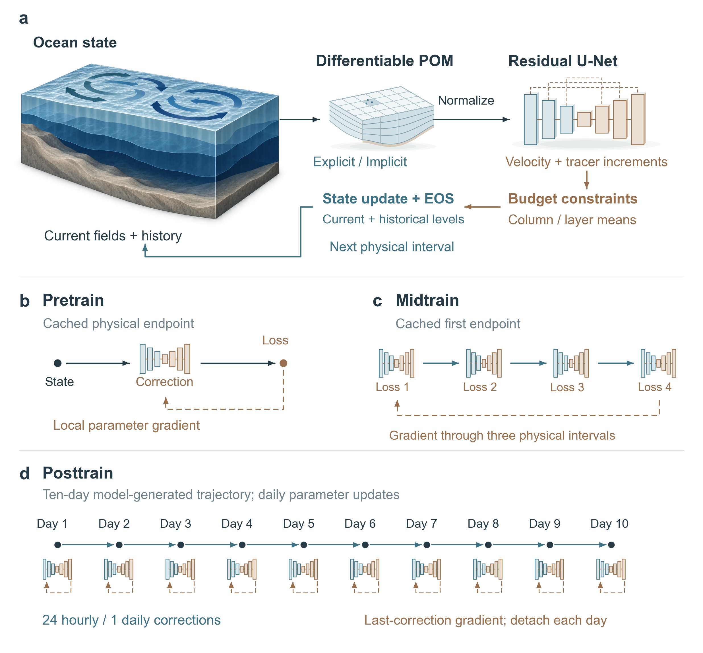

<h1 align="center">NeuralPOM</h1>

<h3 align="center">New Wine in an Old Bottle: A Hybrid Ocean Forecast Model with Differentiable Dynamics and Staged Learning</h3>

<p align="center">
  Ruiqi&nbsp;Shu<sup>1,†</sup> &nbsp;·&nbsp;
  Guangliang&nbsp;Liu<sup>1,†</sup> &nbsp;·&nbsp;
  Ruijian&nbsp;Gou<sup>2,†,*</sup> &nbsp;·&nbsp;
  Tianrun&nbsp;Gao<sup>3</sup> &nbsp;·&nbsp;
  Haomin&nbsp;Wen<sup>5</sup> &nbsp;·&nbsp;
  Hao&nbsp;Li<sup>6,5,4,*</sup> &nbsp;·&nbsp;
  Xiaomeng&nbsp;Huang<sup>1,*</sup>
</p>

<p align="center">
  <a href="paper/NeuralPOM.pdf"><strong>Paper</strong></a>
  &nbsp;·&nbsp;
  <a href="paper/Supplement.pdf"><strong>Supplement</strong></a>
  &nbsp;·&nbsp;
  <a href="https://www.modelscope.cn/datasets/chiyodamomo01/NeuralPOM"><strong>Dataset</strong></a>
  &nbsp;·&nbsp;
  <a href="https://neural-pom.vercel.app/"><strong>Tutorial</strong></a>
  &nbsp;·&nbsp;
  <a href="https://github.com/ChiyodaMomo01/NeuralPOM"><strong>Code</strong></a>
  &nbsp;·&nbsp;
  <a href="docs/reproduction.md"><strong>Reproduction</strong></a>
  &nbsp;·&nbsp;
  <a href="README_zh.md"><strong>简体中文</strong></a>
</p>

<details>
<summary>Affiliations and correspondence</summary>

1. Department of Earth System Science, Tsinghua University, Beijing, China
2. Department of Ocean Big Data and Artificial Intelligence, Laoshan National Laboratory, Qingdao, China
3. School of Computing and Data Science, The University of Hong Kong
4. Shanghai Academy of Artificial Intelligence for Science, Shanghai, China
5. Shanghai Innovation Institute, Shanghai, China
6. Artificial Intelligence Innovation and Incubation Institute, Fudan University, Shanghai, China

† Equal contribution. * Correspondence: [Ruijian Gou](mailto:ruijian.gou@awi.de), [Hao Li](mailto:lihao_lh@fudan.edu.cn), and [Xiaomeng Huang](mailto:hxm@tsinghua.edu.cn).

</details>

---

**NeuralPOM couples differentiable ocean dynamics with learned, conservation-constrained state corrections.** A PyTorch Princeton Ocean Model advances the ocean state; a residual U-Net corrects velocity, temperature and salinity at hourly or daily intervals. The coupled system learns through a three-stage training procedure and makes extended ocean forecasts.

<p align="center">
  
</p>

<p align="center">
  <em>Physical–neural coupling and the Pretrain, Midtrain and Posttrain stages.</em>
</p>

## How NeuralPOM Works

### Differentiable dynamics and constrained correction

The **explicit mode-split** and **semi-implicit free-surface** frameworks integrate the three-dimensional primitive equations in PyTorch. The explicit framework subcycles the fast barotropic mode; the semi-implicit framework solves for free-surface elevation with a differentiable elliptic solver.

The corrector updates baroclinic velocity shear, potential temperature and salinity while preserving column-integrated volume transport and layer-integrated tracer budgets. It applies the same increments to both leapfrog time levels and recomputes density through the equation of state. **Density-Normal Damping (DND)** attenuates the density-modifying part of a tracer correction while retaining its density-compensated component. The physical solver advances free-surface elevation, vertical velocity and turbulent mixing. The [paper](paper/NeuralPOM.pdf) describes the equations and physical diagnostics.

### Three training stages

| Stage | Training trajectory | Gradient path |
|---|---|---|
| **Pretrain** | One correction to a cached physical endpoint | Through the constrained neural update |
| **Midtrain** | Four correction cycles | Through the neural updates and three intervening physical intervals |
| **Posttrain** | Ten-day coupled trajectories | One local update per day, with state detachment between days |

The reference ensembles are generated on a **354 × 322** horizontal grid and restricted to a **90 × 82** forecast grid with **15 active vertical layers**. The network maps **101 input channels** to **60 correction channels**. Reference ensembles are available on [ModelScope](https://www.modelscope.cn/datasets/chiyodamomo01/NeuralPOM); the [tutorial](https://neural-pom.vercel.app/) covers data, numerics and training.

### Physical cases and forecast evaluation

| Case | Physical setting |
|---|---|
| **Double gyre** | Wind-driven baroclinic circulation in a closed basin |
| **Coastal tide** | Tidal propagation through an open-boundary coastal channel |
| **Stratified seamount** | Stratified water over isolated topography |
| **Jiaozhou Bay** | Tidal circulation with realistic bathymetry and coastline |

The paper compares the dynamical frameworks with Fortran POM in these four cases, then evaluates **100-day hybrid forecasts** against physical closures and direct neural forecasts. Forecast errors, spectra and physical diagnostics are reported in the [paper](paper/NeuralPOM.pdf), [supplement](paper/Supplement.pdf) and [source tables](paper/data/).

## Installation

NeuralPOM requires **Python 3.10+** and **PyTorch 2.4+** (with CUDA support for GPU training and evaluation).

```bash
git clone https://github.com/ChiyodaMomo01/NeuralPOM.git
cd NeuralPOM
python -m venv .venv
source .venv/bin/activate
python -m pip install -e ".[test]"

export OMP_NUM_THREADS=1
export MKL_NUM_THREADS=1
export TORCHINDUCTOR_COMPILE_THREADS=1
```

Installing `.[test]` also installs `pytest` and `timm` (used by the direct neural baseline architectures in `.[ai]`). Package metadata and console entry points (`neuralpom` and `neuralpom-ai`) are defined in [`pyproject.toml`](pyproject.toml).

---

## Quick Start: Configuration, Training, and Evaluation

### 1. Download Dataset and Configure Paths

Reference ensembles are available on [ModelScope](https://www.modelscope.cn/datasets/chiyodamomo01/NeuralPOM). Portable configuration templates in [`configs/examples/`](configs/examples/) preserve the manuscript's scientific settings while using relative paths and offline W&B logging:

| Dynamical Framework | Correction Interval | Portable Template |
|---|---|---|
| Explicit mode-split (`explicit`) | 1 hour (`1h`) | [`configs/examples/explicit_1h.json`](configs/examples/explicit_1h.json) |
| Explicit mode-split (`explicit`) | 1 day (`1day`) | [`configs/examples/explicit_1day.json`](configs/examples/explicit_1day.json) |
| Semi-implicit (`implicit_p0_fixed`) | 1 hour (`1h`) | [`configs/examples/implicit_1h.json`](configs/examples/implicit_1h.json) |
| Semi-implicit (`implicit_p0_fixed`) | 1 day (`1day`) | [`configs/examples/implicit_1day.json`](configs/examples/implicit_1day.json) |

Run commands from the repository root. Relative paths inside a training configuration resolve from its directory; paths in the evaluation protocol resolve from the repository root.

Copy a template to a local working configuration and set `data_root` (pointing to the matching reference ensemble) and `run_root` (output directory for caches and checkpoints):

```bash
mkdir -p configs/local
cp configs/examples/explicit_1day.json configs/local/explicit_1day.json
```

### 2. Inspect Training Plan, Prepare Caches, and Train

The registered training setup uses 8 DistributedDataParallel (DDP) processes. You can invoke the workflow via the `neuralpom` console script, `python -m neuralpom.v1.cli`, or the wrapper scripts in `scripts/v1/`:

```bash
CONFIG=configs/local/explicit_1day.json

# 1. Inspect sample counts and optimizer update budgets without loading data
python scripts/v1/plan.py --config "$CONFIG"

# 2. Build uncorrected single-step endpoint caches and training-split normalization statistics
torchrun --standalone --nproc_per_node=8 \
  -m neuralpom.v1.cli --config "$CONFIG" prepare

# 3. Run the three-stage training procedure sequentially (Pretrain -> Midtrain -> Posttrain)
set -e
for stage in pretrain midtrain4 posttrain; do
  torchrun --standalone --nproc_per_node=8 \
    -m neuralpom.v1.cli --config "$CONFIG" train --stage "$stage"
done
```

Frozen stage weights are exported to `run_root/frozen/{pretrain,midtrain4,posttrain}.pt`, and full restart checkpoints (including model weights, AdamW state, sampling cursor, per-rank RNG states, and multi-level physical states) are saved automatically so an interrupted stage resumes when the command is repeated.

### 3. Run 100-Day Closed-Loop Evaluation

The paired evaluation protocol [`configs/examples/evaluation_100d.json`](configs/examples/evaluation_100d.json) defines 100-day forecasts across 16 forecast origins for all four framework–interval groups under bare eager physical execution. Point the desired group's `config` entry to your training configuration, then run the corresponding forecast worker:

```bash
# Run a single hybrid variant with Density-Normal Damping (CLI policy: density75)
CUDA_VISIBLE_DEVICES=0 python -m neuralpom.evaluation.campaign worker \
  --protocol configs/examples/evaluation_100d.json \
  --variant explicit_1day_posttrain_density75 \
  --device cuda:0

# Run the paired coarse-grid Smagorinsky physical baseline for the same dynamical framework
CUDA_VISIBLE_DEVICES=0 python -m neuralpom.evaluation.campaign worker \
  --protocol configs/examples/evaluation_100d.json \
  --variant explicit_1day_physics_physics \
  --device cuda:0

# Generate an aggregated evaluation summary and diagnostic report
python -m neuralpom.evaluation.report \
  --protocol configs/examples/evaluation_100d.json \
  --out runs/evaluation_100d/report
```

Variant identifiers follow the convention `<group>_<stage>_<policy>`, where `<group>` is one of `explicit_1h`, `explicit_1day`, `implicit_p0_fixed_1h`, or `implicit_p0_fixed_1day`; `<stage>` is `pretrain`, `midtrain4`, `posttrain`, or `physics`; and `<policy>` is `density75` (DND), `constrained` (undamped constrained update), `raw` (unconstrained increment), or `physics`. See the [Reproduction Guide](docs/reproduction.md) and [Online Tutorial](https://neural-pom.vercel.app/) for detailed asset layouts and scoring protocols.

### 4. Direct Neural Baselines and Four-Case Dynamical Adapters

The direct daily 313-channel neural forecasting baselines (`triton`, `simvp`, `resunet`, `convlstm`, `pastnet`) are managed through the `neuralpom-ai` entry point (`neuralpom.ai_baselines.cli`):

```bash
AI_CONFIG=configs/ai/implicit_p0_fixed_daily.json
neuralpom-ai plan --config "$AI_CONFIG"
torchrun --standalone --nproc_per_node=8 -m neuralpom.ai_baselines.cli prepare --config "$AI_CONFIG"
torchrun --standalone --nproc_per_node=8 -m neuralpom.ai_baselines.cli train --config "$AI_CONFIG" --stage pretrain
torchrun --standalone --nproc_per_node=8 -m neuralpom.ai_baselines.cli train --config "$AI_CONFIG" --stage posttrain
torchrun --standalone --nproc_per_node=8 -m neuralpom.ai_baselines.cli evaluate --config "$AI_CONFIG" --stage posttrain --days 100
```

To run forward physical integrations of the four benchmark cases (`double_gyre`, `coastal_tide`, `seamount`, `jiaozhou_bay`) from a Fortran-compatible reference initial state:

```python
import torch
from neuralpom.cores.case_adapters import core_from_reference

core = core_from_reference("initial_state.npz", case="jiaozhou_bay", family="implicit")
core.iend = 1
with torch.no_grad():
    core.run_time_loop()
```

### 5. Regression Test Suite

Run the unit and numerical regression suite from the repository root:

```bash
python -m pytest -q
```

---

## Repository Structure

```text
src/neuralpom/
  cores/                 # Differentiable explicit and semi-implicit POM dynamical frameworks & 4-case adapters
  models/                # Residual U-Net corrector and neural network components
  hybrid/                # Conservation-constrained state updates and coupled rollout execution
  v1/                    # Data loading, endpoint caches, staged training (Pretrain/Midtrain/Posttrain), and CLI
  evaluation/            # Process-isolated campaign runner, Density-Normal Damping, spectral/field diagnostics, and reports
  ai_baselines/          # Direct 313-channel autoregressive neural forecasting baselines
configs/
  examples/              # Portable training templates (explicit/implicit, 1h/1day) and 100-day evaluation protocol
scripts/v1/              # Campaign planning, preparation, training, and evaluation entry scripts
tests/                   # Regression suite for numerical operators, adjoints, conservation projections, and restarts
docs/                    # Reproduction guide and VitePress documentation source
paper/                   # Final manuscript PDF, supplementary PDF, figures, and source data
```

---

## Citation

```bibtex
@misc{shu2026neuralpom,
  title  = {New Wine in an Old Bottle: NeuralPOM: A Hybrid Ocean Forecast Model with Differentiable Dynamics and Staged Learning},
  author = {Shu, Ruiqi and Liu, Guangliang and Gou, Ruijian and Gao, Tianrun and Wen, Haomin and Li, Hao and Huang, Xiaomeng},
  year   = {2026},
  note   = {Unpublished manuscript},
  url    = {https://github.com/ChiyodaMomo01/NeuralPOM}
}
```

## License

NeuralPOM is licensed under the [Apache License 2.0](LICENSE).
