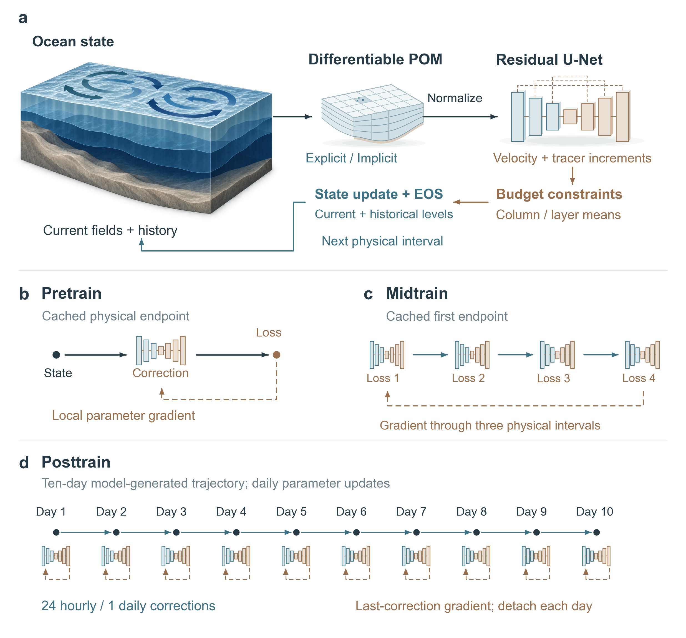

<h1 align="center">NeuralPOM</h1>

<h3 align="center">New Wine in an Old Bottle: A Hybrid Ocean Forecast Model with Differentiable Dynamics and Staged Learning</h3>

<p align="center">
  Ruiqi&nbsp;Shu<sup>1,2,†</sup> &nbsp;·&nbsp;
  Guangliang&nbsp;Liu<sup>1,3,4,†</sup> &nbsp;·&nbsp;
  Ruijian&nbsp;Gou<sup>5,†,*</sup> &nbsp;·&nbsp;
  Tianrun&nbsp;Gao<sup>6</sup> &nbsp;·&nbsp;
  Haomin&nbsp;Wen<sup>7</sup> &nbsp;·&nbsp;
  Hao&nbsp;Li<sup>8,7,2,*</sup> &nbsp;·&nbsp;
  Xiaomeng&nbsp;Huang<sup>1,*</sup>
</p>

<p align="center">
  <a href="paper/NeuralPOM.pdf"><strong>论文 (Paper)</strong></a>
  &nbsp;·&nbsp;
  <a href="paper/Supplement.pdf"><strong>补充材料 (Supplement)</strong></a>
  &nbsp;·&nbsp;
  <a href="https://www.modelscope.cn/datasets/chiyodamomo01/NeuralPOM"><strong>数据集 (Dataset)</strong></a>
  &nbsp;·&nbsp;
  <a href="https://neural-pom.vercel.app/"><strong>在线教程 (Tutorial)</strong></a>
  &nbsp;·&nbsp;
  <a href="https://github.com/ChiyodaMomo01/NeuralPOM"><strong>代码仓库 (Code)</strong></a>
  &nbsp;·&nbsp;
  <a href="docs/reproduction.md"><strong>复现指南 (Reproduction)</strong></a>
  &nbsp;·&nbsp;
  <a href="README.md"><strong>English</strong></a>
</p>

<details>
<summary>作者单位与通讯作者</summary>

1. Department of Earth System Science, Tsinghua University, Beijing, China
2. Shanghai Academy of Artificial Intelligence for Science, Shanghai, China
3. State Key Laboratory of Physical Oceanography, Institute of Oceanographic Instrumentation, Shandong Academy of Sciences, Qingdao, China
4. Key Laboratory of Computing Power Network and Information Security, Ministry of Education, Shandong Computer Science Center, Qilu University of Technology (Shandong Academy of Sciences), Jinan, China
5. Department of Ocean Big Data and Artificial Intelligence, Laoshan National Laboratory, Qingdao, China
6. School of Computing and Data Science, The University of Hong Kong
7. Shanghai Innovation Institute, Shanghai, China
8. Artificial Intelligence Innovation and Incubation Institute, Fudan University, Shanghai, China

† 共同第一作者（同等贡献）。* 通讯作者：[Ruijian Gou](mailto:ruijian.gou@awi.de)、[Hao Li](mailto:lihao_lh@fudan.edu.cn)、[Xiaomeng Huang](mailto:hxm@tsinghua.edu.cn)。

</details>

---

**NeuralPOM 将可微海洋动力学与守恒约束神经状态校正结合起来。** PyTorch 实现的普林斯顿海洋模式（POM）推进海洋状态，残差 U-Net 按小时或按日校正速度、位温与盐度。耦合系统通过三阶段训练学习，随后用于长时间海洋预报。

<p align="center">
  
</p>

<p align="center">
  <em>物理–神经耦合，以及 Pretrain、Midtrain 和 Posttrain 三个训练阶段。</em>
</p>

## 方法概述

### 可微动力学与守恒约束校正

**显式分裂框架**与**半隐式自由面框架**均以 PyTorch 实现三维原始方程。显式框架对子步长上的快速正压模态积分，半隐式框架通过可微椭圆求解器计算自由面高度。

神经校正器更新斜压速度切变、位温和盐度，同时保持垂向积分体积输运与逐层示踪物收支。相同增量同步施加于蛙跳格式的两个时间层，随后通过状态方程重新计算密度。**密度法向阻尼（DND）**衰减示踪物校正中改变密度的分量，同时保留密度补偿分量。自由面高度、垂向速度和湍流混合由物理求解器继续推进。方程与物理诊断见[论文](paper/NeuralPOM.pdf)。

### 三阶段训练

| 阶段 | 训练轨迹 | 梯度路径 |
|---|---|---|
| **Pretrain** | 校正一个缓存的物理预报终点 | 通过守恒约束神经更新 |
| **Midtrain** | 四个校正周期 | 通过神经更新和三个中间物理积分区间 |
| **Posttrain** | 十天耦合轨迹 | 每天一次局部参数更新，日间状态截断梯度 |

参考集合由 **354 × 322** 水平网格生成，并限制到 **90 × 82** 的预报网格，含 **15 个有效垂向层**。网络将 **101 个输入通道**映射为 **60 个校正通道**。参考集合见 [ModelScope](https://www.modelscope.cn/datasets/chiyodamomo01/NeuralPOM)，数据、数值方法与训练说明见[在线教程](https://neural-pom.vercel.app/)。

### 物理算例与预报评估

| 算例 | 物理背景 |
|---|---|
| **双涡旋海盆** | 封闭海盆内的风驱斜压环流 |
| **近岸潮汐** | 开边界近岸水道中的潮波传播 |
| **层结海山** | 孤立地形上方的层结海水 |
| **胶州湾** | 真实水深与岸线下的潮汐环流 |

论文在上述四类算例中将可微动力框架与 Fortran POM 对照，并通过 **100 天混合预报**比较物理闭合方案与纯神经预报。误差、波数谱与物理诊断见[论文](paper/NeuralPOM.pdf)、[补充材料](paper/Supplement.pdf)和[源数据表](paper/data/)。

## 环境安装

NeuralPOM 需要 **Python 3.10+** 与 **PyTorch 2.4+**（GPU 训练与评估需配置 CUDA 环境）。

```bash
git clone https://github.com/ChiyodaMomo01/NeuralPOM.git
cd NeuralPOM
python -m venv .venv
source .venv/bin/activate
python -m pip install -e ".[test]"

export OMP_NUM_THREADS=1
export MKL_NUM_THREADS=1
export TORCHINDUCTOR_COMPILE_THREADS=1
```

安装 `.[test]` 会同时安装 `pytest` 与 `timm`（供 `.[ai]` 中的纯神经基线模型使用）。包依赖与命令行入口（`neuralpom` 与 `neuralpom-ai`）定义在 [`pyproject.toml`](pyproject.toml) 中。

---

## 快速开始：配置、训练与闭环评估

### 1. 获取数据集与配置路径

参考集合可从以下地址获取： [ModelScope 数据集主页](https://www.modelscope.cn/datasets/chiyodamomo01/NeuralPOM)。[`configs/examples/`](configs/examples/) 目录提供了四组训练配置的可移植模板（默认采用相对路径与离线 W&B 记录）：

| 动力框架 | 校正间隔 $\Delta$ | 可移植配置模板 |
|---|---|---|
| 显式模态分裂 (`explicit`) | 1 小时 (`1h`) | [`configs/examples/explicit_1h.json`](configs/examples/explicit_1h.json) |
| 显式模态分裂 (`explicit`) | 1 天 (`1day`) | [`configs/examples/explicit_1day.json`](configs/examples/explicit_1day.json) |
| 半隐式自由表面 (`implicit_p0_fixed`) | 1 小时 (`1h`) | [`configs/examples/implicit_1h.json`](configs/examples/implicit_1h.json) |
| 半隐式自由表面 (`implicit_p0_fixed`) | 1 天 (`1day`) | [`configs/examples/implicit_1day.json`](configs/examples/implicit_1day.json) |

以下命令从仓库根目录运行。训练配置内的相对路径以配置文件所在目录为基准；评估协议内的路径以仓库根目录为基准。

将所需模板复制至本地工作配置，并修改其中的 `data_root`（指向对应动力框架的参考数据集目录）与 `run_root`（缓存与权重输出目录）：

```bash
mkdir -p configs/local
cp configs/examples/explicit_1day.json configs/local/explicit_1day.json
```

### 2. 查看训练计划、构建缓存与三阶段训练

标准训练采用 8 卡 DistributedDataParallel (DDP)。可通过 `neuralpom` 命令、`python -m neuralpom.v1.cli` 或 `scripts/v1/` 下的入口脚本运行：

```bash
CONFIG=configs/local/explicit_1day.json

# 1. 在不加载数据的情况下检查各阶段样本数与优化步数预算
python scripts/v1/plan.py --config "$CONFIG"

# 2. 构建单步无校正物理终点缓存与训练集归一化统计量
torchrun --standalone --nproc_per_node=8 \
  -m neuralpom.v1.cli --config "$CONFIG" prepare

# 3. 依次执行三阶段训练 (Pretrain -> Midtrain -> Posttrain)
set -e
for stage in pretrain midtrain4 posttrain; do
  torchrun --standalone --nproc_per_node=8 \
    -m neuralpom.v1.cli --config "$CONFIG" train --stage "$stage"
done
```

各阶段冻结权重会自动导出至 `run_root/frozen/{pretrain,midtrain4,posttrain}.pt`，完整断点文件（含模型参数、AdamW 状态、采样游标、各进程随机数状态及多时间层物理状态）支持重复执行同一命令继续训练。

### 3. 运行 100 天闭环冻结评估

配对评估协议 [`configs/examples/evaluation_100d.json`](configs/examples/evaluation_100d.json) 定义了全部四组“动力框架–耦合间隔”在 16 个预报初态上的 100 天闭环积分评估。将协议中对应分组的 `config` 字段指向本地训练配置后，可运行对应配置的预报进程：

```bash
# 运行启用密度法向阻尼 (DND, CLI 策略名: density75) 的混合预报变体
CUDA_VISIBLE_DEVICES=0 python -m neuralpom.evaluation.campaign worker \
  --protocol configs/examples/evaluation_100d.json \
  --variant explicit_1day_posttrain_density75 \
  --device cuda:0

# 运行同一动力框架下配对的粗网格 Smagorinsky 物理基线
CUDA_VISIBLE_DEVICES=0 python -m neuralpom.evaluation.campaign worker \
  --protocol configs/examples/evaluation_100d.json \
  --variant explicit_1day_physics_physics \
  --device cuda:0

# 生成汇总统计与诊断报告
python -m neuralpom.evaluation.report \
  --protocol configs/examples/evaluation_100d.json \
  --out runs/evaluation_100d/report
```

变体标识符遵循 `<group>_<stage>_<policy>` 格式：`<group>` 取 `explicit_1h`、`explicit_1day`、`implicit_p0_fixed_1h` 或 `implicit_p0_fixed_1day`；`<stage>` 取 `pretrain`、`midtrain4`、`posttrain` 或 `physics`；`<policy>` 取 `density75`（DND）、`constrained`（无阻尼守恒约束）、`raw`（无约束原始增量）或 `physics`。详细资产目录结构与评分规范见[复现指南](docs/reproduction.md)与[在线教程](https://neural-pom.vercel.app/)。

### 4. 纯神经基线与四算例动力适配接口

日频 313 通道纯数据驱动自回归基线（`triton`、`simvp`、`resunet`、`convlstm`、`pastnet`）通过 `neuralpom-ai`（`neuralpom.ai_baselines.cli`）统一管理：

```bash
AI_CONFIG=configs/ai/implicit_p0_fixed_daily.json
neuralpom-ai plan --config "$AI_CONFIG"
torchrun --standalone --nproc_per_node=8 -m neuralpom.ai_baselines.cli prepare --config "$AI_CONFIG"
torchrun --standalone --nproc_per_node=8 -m neuralpom.ai_baselines.cli train --config "$AI_CONFIG" --stage pretrain
torchrun --standalone --nproc_per_node=8 -m neuralpom.ai_baselines.cli train --config "$AI_CONFIG" --stage posttrain
torchrun --standalone --nproc_per_node=8 -m neuralpom.ai_baselines.cli evaluate --config "$AI_CONFIG" --stage posttrain --days 100
```

使用 `neuralpom.cores.case_adapters` 由 Fortran 兼容初态推进四类海洋物理基准算例（`double_gyre`、`coastal_tide`、`seamount`、`jiaozhou_bay`）：

```python
import torch
from neuralpom.cores.case_adapters import core_from_reference

core = core_from_reference("initial_state.npz", case="jiaozhou_bay", family="implicit")
core.iend = 1
with torch.no_grad():
    core.run_time_loop()
```

### 5. 回归测试套件

在仓库根目录下运行单元与数值回归测试：

```bash
python -m pytest -q
```

---

## 仓库目录结构

```text
src/neuralpom/
  cores/                 # 可微显式与半隐式 POM 动力框架及四类物理基准算例适配器
  models/                # 残差 U-Net 校正网络与神经网络组件
  hybrid/                # 守恒约束状态更新算子与物理–神经耦合推进接口
  v1/                    # 数据加载、终点缓存、三阶段训练 (Pretrain/Midtrain/Posttrain) 与 CLI
  evaluation/            # 进程隔离评估调度、密度法向阻尼 (DND)、波数谱/空间场诊断与报告生成
  ai_baselines/          # 313 通道全状态直接自回归神经预报基线
configs/
  examples/              # 可移植训练配置模板 (显式/半隐式, 小时/日频) 与 100 天评估协议
scripts/v1/              # 训练预算规划、数据准备、训练与评估脚本入口
tests/                   # 数值算子、伴随梯度、守恒投影与断点续训回归测试套件
docs/                    # 复现指南与 VitePress 教程文档源码
paper/                   # 论文终稿 PDF、补充材料 PDF、图表与源数据
```

---

## 引用格式 (Citation)

```bibtex
@misc{shu2026neuralpom,
  title  = {New Wine in an Old Bottle: NeuralPOM: A Hybrid Ocean Forecast Model with Differentiable Dynamics and Staged Learning},
  author = {Shu, Ruiqi and Liu, Guangliang and Gou, Ruijian and Gao, Tianrun and Wen, Haomin and Li, Hao and Huang, Xiaomeng},
  year   = {2026},
  note   = {Unpublished manuscript},
  url    = {https://github.com/ChiyodaMomo01/NeuralPOM}
}
```

## 许可证

NeuralPOM 采用 [Apache License 2.0](LICENSE)。
