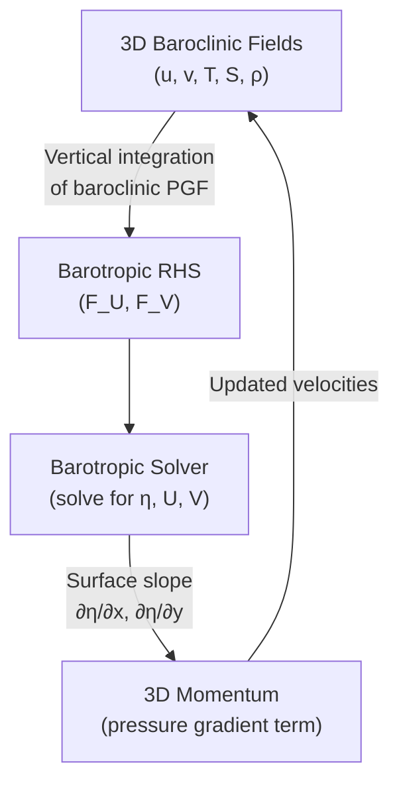

# Barotropic-Baroclinic Mode Splitting

A critical feature of NeuralPOM is the separation of the ocean circulation into fast barotropic (external) modes and slow baroclinic (internal) modes. This mode splitting allows the model to efficiently handle both the rapidly propagating surface gravity waves and the slower three-dimensional density-driven currents.

---

## Motivation

The primitive equations support two distinct classes of motion:

| Mode | Character | Speed | Time Step Required |
|------|-----------|-------|--------------------|
| **Barotropic (external)** | Depth-independent, surface gravity waves | $c_0 = \sqrt{gH}$ (~200 m/s in deep ocean) | Small ($\Delta t_{\text{BT}} \sim$ 1--10 s) |
| **Baroclinic (internal)** | Depth-dependent, density-driven | $\sim$ 1--3 m/s | Larger ($\Delta t_{\text{BC}} \sim$ 100--1000 s) |

Without splitting, the entire 3D model would be constrained by the CFL condition of the fastest surface waves. Mode splitting solves the depth-integrated barotropic equations at a much smaller time step than the three-dimensional baroclinic equations, dramatically improving computational efficiency.

---

## Depth-Integrated (Barotropic) Equations

The barotropic equations are obtained by vertically integrating the primitive equations from the bottom $z = -H$ to the surface $z = \eta$.

### Continuity (Free Surface Evolution)

$$
\frac{\partial \eta}{\partial t} + \frac{\partial (D \bar{u})}{\partial x} + \frac{\partial (D \bar{v})}{\partial y} = 0
$$

where $D = H + \eta$ is the total water depth, and $\bar{u}, \bar{v}$ are the depth-averaged velocities:

$$
\bar{u} = \frac{1}{D} \int_{-H}^{\eta} u \, dz, \qquad
\bar{v} = \frac{1}{D} \int_{-H}^{\eta} v \, dz
$$

The depth-integrated volume transports are:

$$
U = D \bar{u} = \int_{-H}^{\eta} u \, dz, \qquad
V = D \bar{v} = \int_{-H}^{\eta} v \, dz
$$

### Momentum (Depth-Integrated)

$$
\frac{\partial U}{\partial t} + (\text{advection} + \text{diffusion})_U - f V = -g D \frac{\partial \eta}{\partial x} + \frac{\tau_s^x - \tau_b^x}{\rho_0} + F_U^{\text{baroclinic}}
$$

$$
\frac{\partial V}{\partial t} + (\text{advection} + \text{diffusion})_V + f U = -g D \frac{\partial \eta}{\partial y} + \frac{\tau_s^y - \tau_b^y}{\rho_0} + F_V^{\text{baroclinic}}
$$

The $F^{\text{baroclinic}}$ terms contain the vertically integrated baroclinic pressure gradient, advection, and horizontal diffusion from the 3D fields, coupling the barotropic and baroclinic modes.

---

## Baroclinic (Internal) Equations

The baroclinic equations describe the vertical structure of the flow. They are obtained by subtracting the depth-averaged (barotropic) flow from the full 3D flow:

$$
u' = u - \bar{u}, \qquad v' = v - \bar{v}
$$

The vertical shear evolves according to the 3D momentum equations:

$$
\frac{\partial u'}{\partial t} + \vec{v} \cdot \nabla u' - f v' = -\frac{1}{\rho_0} \frac{\partial p_{\text{bc}}}{\partial x} + \frac{\partial}{\partial z} \left( K_M \frac{\partial u'}{\partial z} \right) + F_u'
$$

where $p_{\text{bc}}$ is the baroclinic pressure (density-driven component), computed by vertical integration of the horizontal density gradient in `baropg()`.

---

## The Free Surface $\eta$ as Coupling Variable

The free surface elevation $\eta(x, y, t)$ is the central variable linking the two modes:



1. **Baroclinic to Barotropic**: The vertically integrated baroclinic pressure gradient, advection, and diffusion terms are computed from 3D fields and passed to the barotropic solver as forcing terms.
2. **Barotropic to Baroclinic**: The updated surface elevation $\eta$ provides the surface slope component of the 3D pressure gradient for the next baroclinic time step.

In the code, the surface pressure gradient in `advu` is computed as:

```python
# Gradient of Elevation (Future + Back)
grad_eg = (egf[s_i, s_j] - egf[s_im1, s_j]) + (egb[s_i, s_j] - egb[s_im1, s_j])

# Gradient of Atmos Pressure
grad_pa = 2.0 * (e_atmos[s_i, s_j] - e_atmos[s_im1, s_j])

press_grad = grav * 0.125 * _b(dt_sum * (grad_eg + grad_pa) * dy_sum)
```

Here, `egf` and `egb` represent the forward and backward time levels of $\eta$ for the leapfrog integration.

---

## Implicit Barotropic Formulation

NeuralPOM's implicit core (`implicit_barotropic.py`) solves the barotropic equations semi-implicitly, which relaxes the CFL constraint on surface gravity waves.

### The Elliptic Equation for $\eta$

The semi-implicit discretization leads to a Helmholtz-type elliptic equation for the free surface:

$$
\eta - 4 \Delta t^2 g \alpha \nabla \cdot (D \nabla \eta) = \text{RHS}
$$

In operator form:

$$
\mathcal{L}(\eta) = \eta - 4 \Delta t_i^2 g \alpha \nabla \cdot (D \nabla \eta)
$$

where $\alpha$ is the implicitness parameter (typically 1.0 for fully implicit, or 0.5 for Crank-Nicolson).

The elliptic operator is implemented in `apply_elliptic_operator`:

```python
def apply_elliptic_operator(self, eta, d_2d):
    # H at U/V faces (Arakawa C)
    H_u_east = 0.5 * (d_2d[s_i_p1, s_j] + d_2d[s_i, s_j])
    H_u_west = 0.5 * (d_2d[s_i, s_j] + d_2d[s_i_m1, s_j])
    H_v_north = 0.5 * (d_2d[s_i, s_j_p1] + d_2d[s_i, s_j])
    H_v_south = 0.5 * (d_2d[s_i, s_j] + d_2d[s_i, s_j_m1])

    # Fluxes with land mask (dum @ U-faces, dvm @ V-faces)
    flux_x_east = H_u_east * (eta[s_i_p1, s_j] - eta[s_i, s_j]) / dx_east * dy_east * dum
    flux_x_west = H_u_west * (eta[s_i, s_j] - eta[s_i_m1, s_j]) / dx_west * dy_west * dum
    flux_y_north = H_v_north * (eta[s_i, s_j_p1] - eta[s_i, s_j]) / dy_north * dx_north * dvm
    flux_y_south = H_v_south * (eta[s_i, s_j] - eta[s_i, s_j_m1]) / dy_south * dx_south * dvm

    div_flux = (flux_x_east - flux_x_west + flux_y_north - flux_y_south) / art
    coeff = 4.0 * (self.dti ** 2) * self.grav * self.alpha
    out[s_i, s_j] = eta[s_i, s_j] - coeff * div_flux
    return out
```

### Conjugate Gradient Solver

The elliptic system $\mathcal{L}(\eta) = \text{RHS}$ is solved using a Conjugate Gradient method:

```python
x = (2.0 * self.el - self.elb).clone()  # warm start: linear extrapolation
r = rhs - self.apply_elliptic_operator(x, d_2d)
p = r.clone()
rs_old = (r * r).sum()

for it in range(max_iter):
    Ap = self.apply_elliptic_operator(p, d_2d)
    alpha = rs_old / (p * Ap).sum()
    x += alpha * p
    r -= alpha * Ap
    rs_new = (r * r).sum()
    if rs_new <= tol * tol:
        break
    beta = rs_new / rs_old
    p = r + beta * p
    rs_old = rs_new
```

A **warm start** using linear extrapolation in time ($\eta^{n+1} \approx 2\eta^n - \eta^{n-1}$) significantly reduces the number of CG iterations required.

### Boundary Conditions for $\eta$

The CG solver supports two types of boundary conditions:

| Problem Type | BC for $\eta$ | Description |
|--------------|---------------|-------------|
| `iproblem == 4, 5` (Double Gyre) | Dirichlet: $\eta = 0$ at boundary | Rigid wall (closed basin) |
| Others | Neumann: $\frac{\partial \eta}{\partial n} = 0$ | Ghost cell equals inner cell |

```python
def _enforce_eta_neumann_bc(self, eta):
    if self.iproblem == 4 or self.iproblem == 5:
        # Dirichlet: rigid wall
        eta[0, :] = 0.0
        eta[-1, :] = 0.0
        eta[:, 0] = 0.0
        eta[:, -1] = 0.0
    else:
        # Neumann: ghost = inner
        eta[0, :] = eta[1, :]
        eta[-1, :] = eta[-2, :]
        eta[:, 0] = eta[:, 1]
        eta[:, -1] = eta[:, -2]
```

---

## Implementation

The production implementations are described in [Explicit core](../cores/explicit.md) and [Semi-implicit core](../cores/implicit.md). The registered time-step and solver settings are defined in `src/neuralpom/v1/core_spec.py`.

Scientific references are listed in the [bibliography](../appendix/references.md); the production configuration is described in [Dynamical cores](../cores/overview.md).
