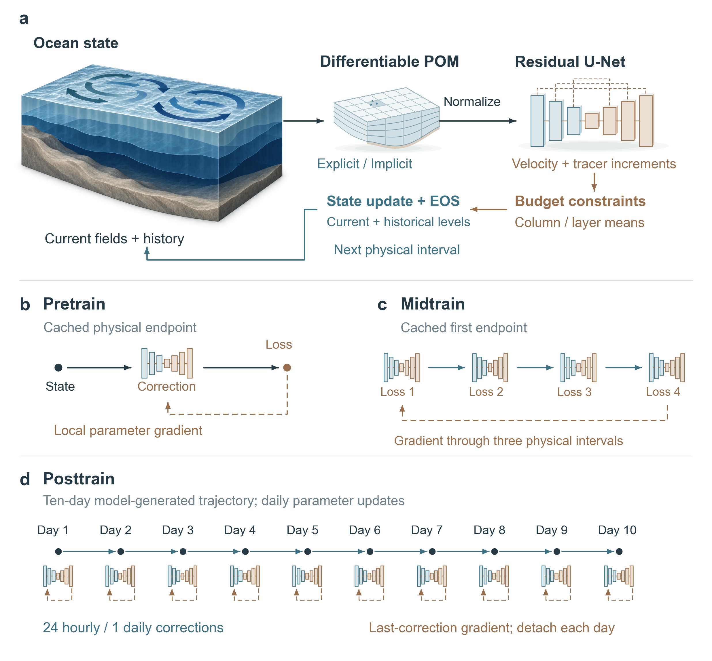
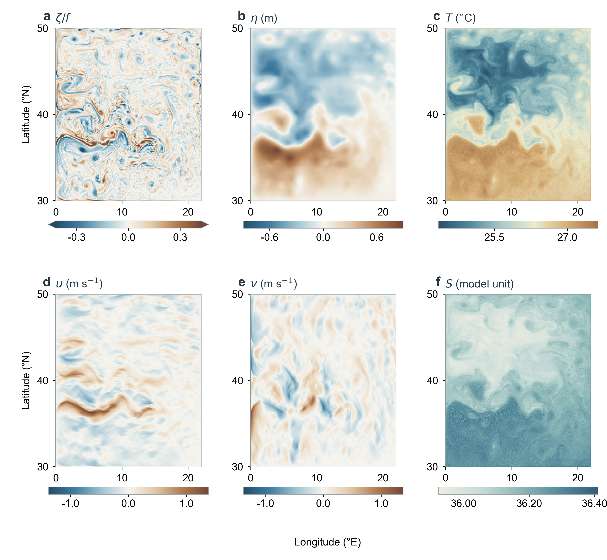
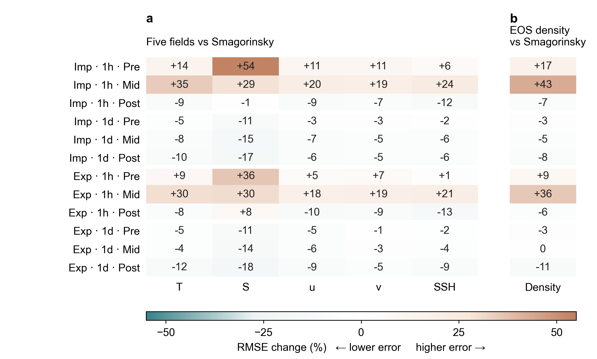
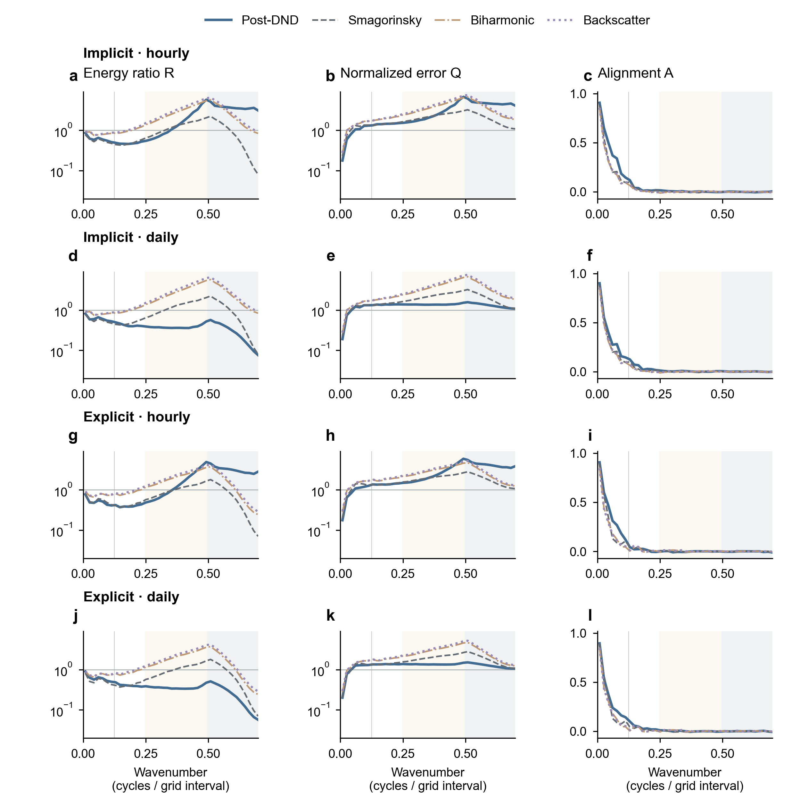
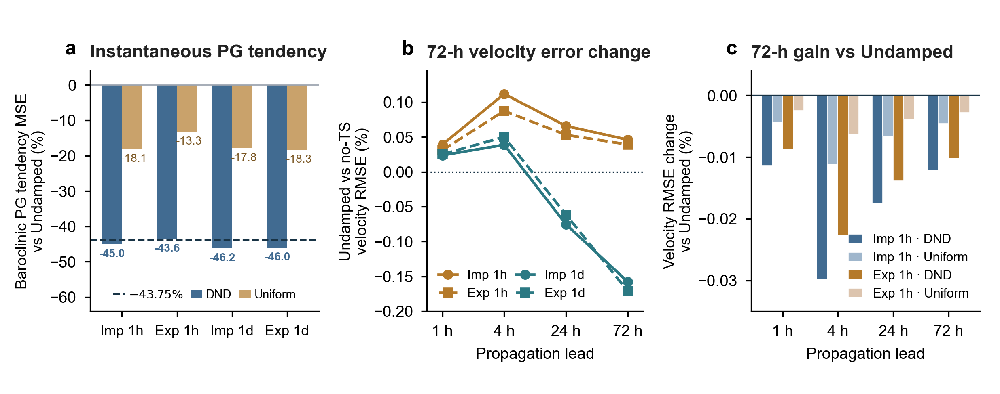
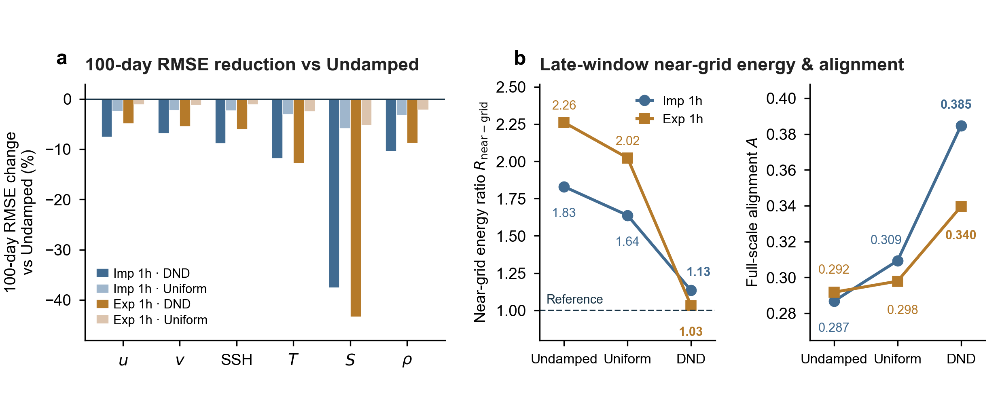
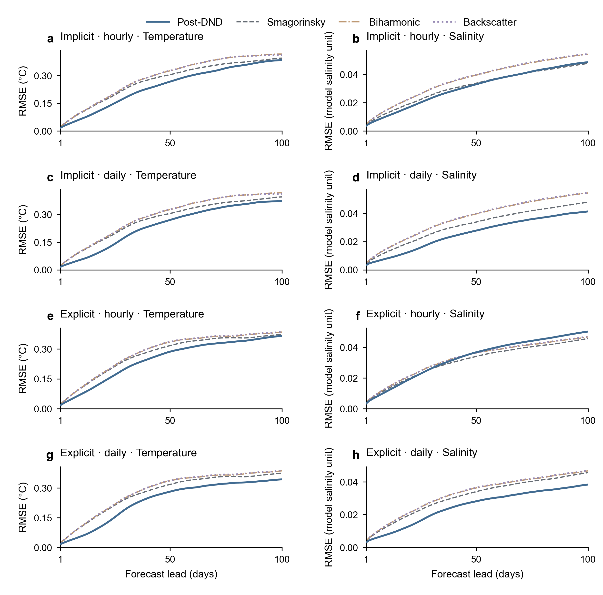
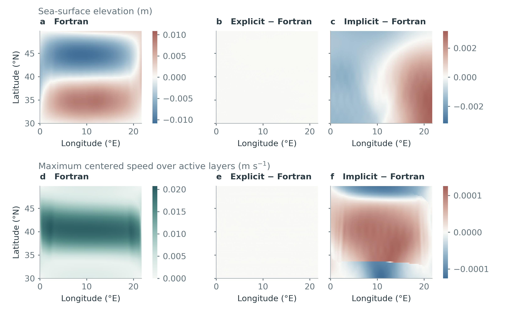
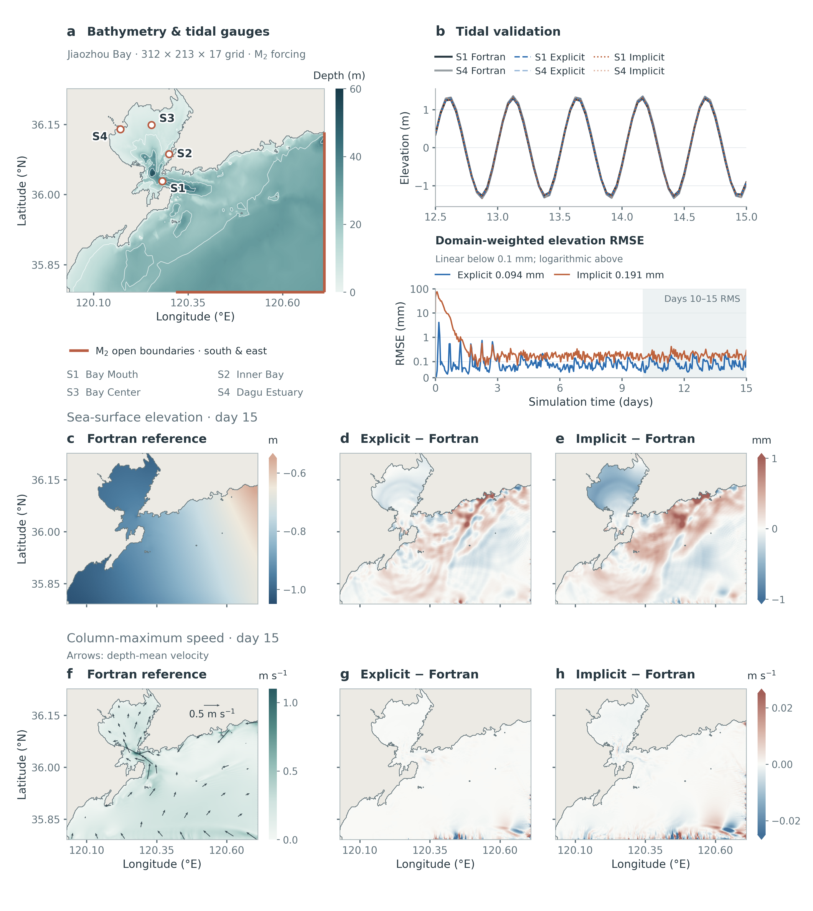

# 旧瓶新酒——NeuralPOM：具有可微动力学与分阶段学习的混合海洋预报模式

**New Wine in an Old Bottle — NeuralPOM: A Hybrid Ocean Forecast Model with Differentiable Dynamics and Staged Learning**

**舒睿骐（Ruiqi Shu）**$^{1,2,\dagger}$，**刘光亮（Guangliang Liu）**$^{1,3,4,\dagger}$，**苟睿健（Ruijian Gou）**$^{5,\dagger}$，**高天润（Tianrun Gao）**$^{6}$，**温浩珉（Haomin Wen）**$^{7}$，**李昊（Hao Li）**$^{8,7,2,*}$，**黄小猛（Xiaomeng Huang）**$^{1,*}$

$^1$ 清华大学地球系统科学系，北京，中国（Department of Earth System Science, Tsinghua University, Beijing, China）  
$^2$ 上海科学智能研究院，上海，中国（Shanghai Academy of Artificial Intelligence for Science, Shanghai, China）  
$^3$ 山东省科学院海洋仪器仪表研究所，物理海洋教育部重点实验室，青岛，中国（State Key Laboratory of Physical Oceanography, Institute of Oceanographic Instrumentation, Shandong Academy of Sciences, Qingdao, China）  
$^4$ 齐鲁工业大学（山东省科学院）山东省计算中心（国家超级计算济南中心），算力互联网与信息安全教育部重点实验室，济南，中国（Key Laboratory of Computing Power Network and Information Security, Ministry of Education, Shandong Computer Science Center, Qilu University of Technology (Shandong Academy of Sciences), Jinan, China）  
$^5$ 崂山实验室海洋大数据与人工智能研究部，青岛，中国（Department of Ocean Big Data and Artificial Intelligence, Laoshan National Laboratory, Qingdao, China）  
$^6$ 香港大学计算与数据科学学院（School of Computing and Data Science, The University of Hong Kong）  
$^7$ 上海创智学院，上海，中国（Shanghai Innovation Institute, Shanghai, China）  
$^8$ 复旦大学人工智能创新与产业研究院，上海，中国（Artificial Intelligence Innovation and Incubation Institute, Fudan University, Shanghai, China）

$^\dagger$ 上述作者贡献相同。  
$^*$ 通信作者：李昊（[lihao_lh@fudan.edu.cn](mailto:lihao_lh@fudan.edu.cn)）、黄小猛（[hxm@tsinghua.edu.cn](mailto:hxm@tsinghua.edu.cn)）。

> 中文全译稿（对应 37 页最新英文定稿 `main.tex` + `content/*.tex` / `NeuralPOM_Report.pdf`）。  
> 图片路径相对于本目录（`figures/*.png`）。全文包含正文 6 图 5 表（图1–图6、表1–表5）与附录 3 图 3 表（图7–图9、表6–表8），章节、公式、图表及参考文献编号（`[1]`–`[35]`）与最新英文 PDF 完全一致。

---

## 摘要

粗网格海洋环流模式依赖难以准确刻画中尺度涡旋的经验次网格参数化方案，而纯数据驱动的神经网络预报器在长时效积分中则会累积轨迹漂移、破坏示踪物守恒并衰减小尺度变率。本文提出混合海洋预报模式 NeuralPOM，将普林斯顿海洋模式（Princeton Ocean Model，POM）的可微显式模态分裂（`Explicit`）及半隐式自由面（`Implicit`）实现同受守恒约束的神经校正器相耦合。三维原始方程求解器负责推进海洋状态，而神经网络则在满足体积、热量和盐量守恒约束的条件下，以高频（$1\,\mathrm h$）或低频（$1\,\mathrm{day}$）间隔周期性更新物理场。基于风生双涡旋海盆中逾 10 万个模式日的细网格参考数据集，我们提出了包含离线单步预训练、跨海洋求解器的多步可微训练以及多日闭环滚动训练的三阶段训练流程。在 100 天预报中，NeuralPOM 在全部预报场上均较粗网格物理闭合方案与直接神经网络预报器降低了误差，在维持中尺度动能的同时提升了涡旋位相对齐度。受控消融实验表明，闭环训练抑制了多日累积漂移，而跨可微求解器反向传播梯度则稳定了高频耦合。最后，由于高频示踪物更新会经由状态方程引入密度异常并激发虚假的斜压压强梯度，我们提出**密度法向阻尼**（Density-Normal Damping，`DND`），选择性衰减改变密度的跨等密面（diapycnal）示踪物分量，同时保留密度补偿的等密面（isopycnal）修正。

---

## 目录

- **1 引言**
- **2 NeuralPOM 框架**
  - 2.1 可微原始方程动力框架
  - 2.2 推理框架：受守恒约束的状态更新与密度法向阻尼
  - 2.3 训练框架：物理引导目标函数与三阶段训练流程
- **3 双涡旋海盆基准与实验方案**
  - 3.1 风生双涡旋海盆参考数据集
  - 3.2 基线模型与评估方案
- **4 预报结果**
  - 4.1 跨动力框架的全状态预报技巧
  - 4.2 与直接神经网络预报模型的对比
  - 4.3 涡旋变率、位相对齐与空间误差结构
  - 4.4 分阶段训练的贡献与受控路线消融
- **5 示踪物校正的斜压反馈与密度法向阻尼**
  - 5.1 斜压压强梯度反馈与密度法向分解
  - 5.2 72 小时单次扰动传播实验
  - 5.3 100 天闭环验证：与各向同性均匀缩放的对比
- **6 讨论**
- **致谢 / 数据与代码可用性**
- **参考文献**
- **附录A 控制方程与数值离散格式**
- **附录B 状态校正接口、目标函数与训练**
- **附录C 逐层约束密度法向投影**
- **附录D 评估协议与物理参数化基线**
- **附录E 直接神经网络预报模型**
- **附录F 可微动力框架的验证**

---

## 1 引言

海洋物理状态预报需要预测水平与垂向海流、自由面高度、位温、盐度、海水密度及湍流混合的三维耦合演变。业务化与气候尺度的海洋模式通过在给定大气强迫和海盆几何条件下数值积分静力、Boussinesq 原始方程来求解这一问题 [1, 2]。然而，在计算成本允许开展延伸期集合或数月积分的网格间距下，数值模式只能部分分辨主导海洋绝大部分动能与示踪物输运的斜压不稳定过程和中尺度涡旋 [3]，而经验次网格闭合必须在数值稳定性与可分辨尺度的过度耗散之间作出平衡。相反，纯数据驱动的神经网络预报器能够以低于数值求解器的计算代价推进逐日海洋状态 [4–7]，但在数周以上的自回归积分中，它们表现出复合轨迹漂移 [4, 5, 8]、逐点均方误差（MSE）目标下近网格中尺度变率的渐进衰减 [8–10]，且在内部层缺乏内建的体积、热量与盐量守恒约束 [10, 11]。

由此产生的一个自然问题是：能否将数值环流模式与机器学习方法相结合，构建兼顾二者优势的混合框架，在保留数值求解器守恒定律与动力平衡的同时利用数据驱动校正弥补未分辨物理过程？近期研究已在理想化和区域海洋模式中嵌入了学习得到的次网格参数化方案 [12–17]，在大气环流模式中实现了端到端可微训练 [10]，并将物理引导的神经校正器与同化模块同海洋动力框架相耦合 [11, 18–20]。然而，迄今大多数海洋混合建模研究仍集中在理想化准地转、正压或浅水配置上，对于神经状态更新如何与完整的三维地形跟随原始方程环流模式——同时预报正压与斜压速度模态、自由面、活跃位温与盐度、非线性状态方程（EOS）以及双方程垂向湍流闭合——相互作用，仍有待系统阐明。

将神经校正器耦合至三维原始方程海洋模式会引入简化模型中不会出现的三个物理与数值挑战。第一，由于每次校正都会改变物理动力框架访问的状态轨迹，仅在离线单步目标上训练的网络在闭环积分期间会遭遇分布偏移 [15, 21]，需要结合跨动力框架的多步可微训练与闭环滚动训练的分阶段训练流程 [22–24]。第二，跨时间步推进求解器需要完整的多时间层状态历史，包括当前与历史蛙跳时间层、正压–斜压模态耦合输运量以及湍动能和混合长度场；破坏蛙跳时间层一致性或水柱体积收支的无约束状态更新会激发计算模态与快速外重力波。第三，位温和盐度是活跃的热力学变量，它们通过非线性 EOS [25] 和静力斜压压强梯度力进入水平动量方程，同时通过湍流闭合中的浮力频率调制垂向粘性与扩散系数 [26]。因此，即便一次示踪物增量在单个时间步上降低了瞬时逐点误差，仍可能引入小尺度密度异常，在后续积分步中产生虚假的斜压压强梯度倾向并扰乱垂向混合。

本文提出建立在三维普林斯顿海洋模式（POM）[27, 28] 之上的混合海洋预报系统 NeuralPOM。NeuralPOM 由两个核心部分组成：可微 PyTorch POM 动力框架——涵盖在理想化和近岸基准算例上经双精度 Fortran POM 验证的显式模态分裂（`Explicit`）与半隐式自由面（`Implicit`）格式——以及在保持体积、热量和盐量守恒约束下周期性更新水平速度、位温和盐度的残差 U-Net 校正器。基于风生双涡旋海盆逾 10 万个模式日的细网格参考集合，我们通过包含离线单步预训练、跨物理动力框架的多步可微训练和 10 天闭环滚动训练的三阶段训练流程对 NeuralPOM 进行训练。在 100 天预报中，NeuralPOM 在全部预报变量上均较粗网格物理参数化方案和直接神经网络预报架构降低了预报误差 [29–32]。分阶段训练演进与受控路线消融实验证实了多步可微训练与闭环滚动训练的互补作用：在多步训练期间跨可微动力框架反向传播梯度稳定了高频逐时耦合下的温盐与环流演化，而多日闭环滚动训练抑制了低频逐日和高频逐时耦合下的累积轨迹漂移。此外，72 小时扰动诊断实验与 100 天闭环积分揭示，在高频逐时耦合下，未经协调的位温与盐度增量会经由非线性 EOS 投影为密度异常并触发虚假的斜压压强梯度反馈；将逐层示踪物增量相对于局地 EOS 密度梯度进行正交分解，并施加**密度法向阻尼**（`DND`）以衰减改变密度的跨等密面（diapycnal）分量、完整保留等密面密度补偿（isopycnal）水团修正，可有效抑制这一不稳定性并持续提升长时效预报技巧。最后，波数谱分析表明，NeuralPOM 维持了物理涡旋动能和近网格变率，同时通过改善中尺度位相对齐度降低了谱误差。

## 2 NeuralPOM 框架

NeuralPOM 在预报循环中交替执行两项操作：可微三维原始方程动力框架在物理积分区间 $\Delta$ 上推进完整的数值海洋状态，受守恒约束的神经校正器在每个区间末端更新物理场（图1）。我们同时考察高频（$\Delta = 1\,\mathrm h$）与低频（$\Delta = 1\,\mathrm{day}$）两种耦合模式，以探究神经状态更新频率与三维原始方程动力学之间的相互作用。

**图1 | 物理–神经耦合与三阶段训练。** **a**，在每个耦合步，物理动力框架将海洋状态输入残差 U-Net，由网络输出受守恒约束的状态增量以更新物理场。**b**，`Pretrain` 在缓存的物理预报场上优化单步校正。**c**，`Midtrain` 跨三个在线可微物理积分区间展开四步校正。**d**，`Posttrain` 在高频（$\Delta=1\,\mathrm h$）或低频（$\Delta=1\,\mathrm{day}$）耦合下积分 10 天闭环轨迹，逐日更新参数并在日间截断梯度。暖棕色虚线箭头表示有效的参数梯度路径。

### 2.1 可微原始方程动力框架

两个动力框架均在交错 Arakawa-C 水平网格和地形跟随 $\sigma$ 坐标下积分普林斯顿海洋模式（POM）的静力、Boussinesq 原始方程 [27]。记水平速度为 $\boldsymbol u_h=(u,v)$、垂向速度为 $w$、物质导数为 $D_t$、科氏参数为 $f$、参考密度为 $\rho_0$、静水压力为 $p$、现场密度为 $\rho$，预报性示踪物为 $C\in\{T,S\}$，连续控制方程为

$$
D_t\boldsymbol u_h+f\boldsymbol e_z\times\boldsymbol u_h=-\rho_0^{-1}\nabla_h p+\mathcal D_m,\qquad \partial_zp=-g\rho,
\tag{2.1}
$$

$$
\nabla_h\cdot\boldsymbol u_h+\partial_zw=0,\qquad D_tC=\mathcal D_C,
\tag{2.2}
$$

其中 $\mathcal D_m$ 和 $\mathcal D_C$ 分别表示次网格动量混合与示踪物混合。海水密度 $\rho(T,S,P)$ 由非线性 Mellor 状态方程（EOS）计算 [25]，垂向粘性系数 $K_M$ 和扩散系数 $K_H$ 由针对湍动能与混合长度尺度 $(q^2,q^2l)$ 的预报性双方程 Mellor–Yamada 2.5 阶湍流闭合方案给出 [26]，参考水平耗散遵循谐波 `Smagorinsky` 公式（$A_H = 0.2A_M$）。

自由面高度 $\eta$ 依据垂向积分连续方程 $\partial_t\eta+\nabla_h\cdot(H\boldsymbol U)=0$ 演化，其中 $H=h+\eta$ 为水柱总深度，$\boldsymbol U=(U,V)$ 为深度平均水平速度。我们在 PyTorch 中实现了两个可微动力框架，二者在内模态时间步长 $\Delta t = 600\,\mathrm s$ 上共享完全相同的三维斜压、温盐和湍流算子，但在快速外重力波的数值积分方式上有所不同。显式模态分裂框架（`Explicit`）直接遵循原始 Fortran 版本 POM 的标准算法实现 [27]：每个内模态步内通过 $N_e=30$ 个蛙跳子步（$\delta t = 20\,\mathrm s$）结合 Robert–Asselin 时间滤波显式子步积分深度平均正压模态，并累加区间平均自由面高度和网格面输运量以维持与三维斜压模态的体积一致性。

在半隐式自由面框架（`Implicit`）中，外模态子步循环被替换为在 $\Delta t = 600\,\mathrm s$ 上采用带离散正弦变换（DST）预条件子的预条件共轭梯度法（PCG）求解前向自由面高度 $\eta^f$ 的椭圆型 Helmholtz 方程；在反向模式自动微分期间，自定义隐式微分伴随算子直接求解面积加权的自伴线性方程组，而不对 PCG 迭代过程展开反向传播，并计入椭圆算子对总水深的敏感度项。附录A给出离散控制方程与伴随形式，附录F在双涡旋海盆、层结海山、理想近岸及真实地形胶州湾潮汐基准算例上验证了两个 PyTorch 框架与双精度 Fortran POM 的一致性。在两种格式中，位温和盐度均通过诊断密度 $\rho$ 经由静力斜压压强梯度与垂向浮力层结强迫动量和湍流方程，且跨区间推进求解器需要当前（$n$）和历史（$b$）蛙跳时间层上完整的 45 变量状态向量。

### 2.2 推理框架：受守恒约束的状态更新与密度法向阻尼

在可微原始方程求解器的基础上，耦合预报推理通过交替执行物理积分与高频（$\Delta=1\,\mathrm h$）或低频（$\Delta=1\,\mathrm{day}$）周期性神经状态更新来向前推进。记 $x_n^+$ 为第 $n$ 个校正循环后的完整数值海洋状态，$\mathcal P^\Delta$ 为时间区间 $\Delta$ 上的物理积分算子，$\mathcal K_\theta$ 为受守恒约束的神经校正算子。每个耦合预报循环按如下方式推进：

$$
x_{n+1}^-=\mathcal P^\Delta(x_n^+),\qquad
x_{n+1}^+=\mathcal K_\theta(x_{n+1}^-).
\tag{2.3}
$$

在每个物理积分区间末端，残差 U-Net 接收 101 个标准化输入通道——包含 $(u^n,u^b,v^n,v^b,T^n,S^n)$ 以及外模态场 $\eta_{\mathrm E}^n$ 和 $(U^n,U^b,V^n,V^b)$——并预测 15 个活跃垂向 $\sigma$ 层上的 60 个原始增量通道 $(\delta u,\delta v,\delta T,\delta S)$（附录B.2）。

为保证神经增量遵守原始方程求解器的守恒定律与时间步进结构，原始网络输出在更新模式状态之前依次经过一系列物理投影（附录B.3）。首先，水平速度增量被投影为满足层厚加权水柱平均为零（$\sum_{k=0}^{14}\Delta\sigma_k\delta u_{ijk}=0$ 且 $\sum_{k=0}^{14}\Delta\sigma_k\delta v_{ijk}=0$），从而将直接动量更新限制在垂向斜压切变上，使深度积分体积输运继续由外模态连续方程控制。位温和盐度增量同样在每个活跃 $\sigma$ 层上被投影为满足体积加权水平平均为零（$\sum_{ij}w_{ijk}\delta T_{ijk}=0$ 且 $\sum_{ij}w_{ijk}\delta S_{ijk}=0$，其中 $w_{ijk}=A_{ij}m_{ij}H_{\mathrm B,ij}\Delta\sigma_k$ 为湿单元体积），从而仅在水平方向重新分配热量和盐量而不引入净层内源汇。

在此基础上，我们将每个 $\sigma$ 层内的标准化温盐增量 $z=(\delta T'/s_T,\delta S'/s_S)$ 相对于局地 EOS 密度梯度作正交分解，拆分为两个同样保持层均值守恒的分量：沿局地密度法向、直接改变海水密度的跨等密面（diapycnal）分量 $Ez$，以及沿等密面切向、不改变局地密度的等密面密度补偿（isopycnal）分量 $(I-E)z$。对改变密度的分量施加缩放因子 $c\in[0,1]$，即得到滤波后的示踪物更新：

$$
z_c=(I-E)z+cEz.
\tag{2.4}
$$

取 $c=1$ 对应无阻尼（`Undamped`）示踪物更新；取 $c=3/4$ 则定义为**密度法向阻尼**（`DND`），即将改变密度的跨等密面分量在振幅上衰减 $25\%$（平方范数缩减 $43.75\%$），同时完整保留密度补偿的水团修正（第5节与附录C）。为避免出现局部极端修正且不破坏零均值守恒，当标准化速度增量或温盐增量的最大绝对值超过阈值 $z_{\max}=5$ 时，按统一比例对其进行整体限幅。随后，所得物理增量被同步加到当前（$n$）和历史（$b$）蛙跳时间层上（对 $f\in\{u,v,T,S\}$，$f^n\leftarrow f^n+\widehat{\delta f}$，$f^b\leftarrow f^b+\widehat{\delta f}$）；这种同步更新在修正状态轨迹的同时保持时间层差值 $f^n-f^b$ 不变，从而避免激发计算模态。最后，三维海水密度 $\rho$ 立即由更新后的 $(T,S)$ 场经非线性状态方程重新计算，而其余预报与诊断场（$\eta$、$\Omega$、湍流变量及正压输运场）则在下一物理积分区间 $\mathcal P^\Delta$ 中完成动力调整。

### 2.3 训练框架：物理引导目标函数与三阶段训练流程

尽管受约束推理算子 $\mathcal K_\theta$ 在每个耦合步强制满足了瞬时守恒与蛙跳时间层一致性，要在数周以上的滚动预报中维持精度与动力稳定性，仍需结合物理引导的目标函数与分阶段训练流程。在每个计分校正步，我们采用复合损失函数 $\ell(x,y)$ 评估更新后的粗网格状态 $x$ 与粗粒化后的细网格参考状态 $y$ 之间的偏差（附录B.4）。除水平速度、位温和盐度的体积加权均方误差外，$\ell(x,y)$ 还包含静力斜压压强梯度一致性项、水平锋面梯度项以及（在多步训练期间加入的）海表高度项，以惩罚动力不平衡的校正增量。

直接在长时效闭环滚动轨迹上从头训练随机初始化的校正器不仅计算开销高昂，且极易在训练初期引发轨迹发散；反之，仅在离线单步目标上训练的网络一旦接入闭环系统，则会遭遇分布偏移与未受约束的动力反馈。为此，我们设计了依次推进的三个训练阶段——`Pretrain`、`Midtrain` 与 `Posttrain`——将训练视界从离线单步状态平滑拓展至多步可微物理积分与多日闭环滚动轨迹（图1b–d与附录B.5）。

在第一阶段单步预训练（`Pretrain`）中，网络在不跨海洋求解器求导的条件下学习初始校正映射。从参考状态 $x_0$ 出发，物理框架在离线状态下推进一个区间以生成缓存的校正前预报场 $x_1^-=\mathcal P^\Delta(x_0)$，并通过极小化相对于参考目标 $y_1$ 的单步损失来优化 $\mathcal K_\theta$：

$$
J_{\mathrm{pre}}(\theta)=\mathbb E\bigl[\ell\bigl(\mathcal K_\theta(x_1^-),\,y_1\bigr)\bigr],\qquad
x_1^-=\mathcal P^\Delta(x_0),
\tag{2.5}
$$

其中 $\mathcal P^\Delta$ 处于自动微分计算图之外。

由于单步预训练无法感知一次状态更新将如何改变后续的物理演化，第二阶段多步可微训练（`Midtrain`）旨在使校正器学习原始方程求解器的跨步动力响应。模型从 `Pretrain` 检查点初始化，并在由三个保留在可微求解器计算图内的在线物理积分区间所连接的四次校正循环上展开（高频 $\Delta=1\,\mathrm h$ 耦合跨越 $4\,\mathrm h$，低频 $\Delta=1\,\mathrm{day}$ 耦合跨越 $4\,\mathrm{days}$）：

$$
J_{\mathrm{mid}}(\theta)=\frac14\sum_{j=1}^{4}\ell(x_j^+,y_j),\qquad
x_j^+=\mathcal K_\theta\bigl(\mathcal P^\Delta(x_{j-1}^+)\bigr).
\tag{2.6}
$$

穿过 $\mathcal P^\Delta$ 的反向传播使得第 $j>1$ 步的端点误差——包括自由面高度误差与速度误差——能够经由线性化原始方程约束较早时刻第 $j-1$ 步的状态更新。

即便经过四步可微训练，数周以上的自回归积分仍会在多日视界上遭遇累积轨迹漂移，而跨越数百个原始方程时间步的完整反向传播在显存上不可行。在最后阶段闭环滚动训练（`Posttrain`）中，模型从 `Midtrain` 检查点初始化，并在连续 10 天闭环滚动轨迹（$d=1,\dots,10$）上积分，使 $\mathcal K_\theta$ 适应延伸期闭环状态分布。记每天包含的耦合循环次数为 $K=\mathrm{1\,day}/\Delta$（低频 $\Delta=1\,\mathrm{day}$ 耦合下 $K=1$，高频 $\Delta=1\,\mathrm h$ 耦合下 $K=24$）。在每个滚动日 $d$，从上一日截断梯度后的状态 $x_{d,0}^+=\operatorname{sg}(x_{d-1,K}^+)$ 出发，耦合系统连续推进 $K$ 个循环，并在每次神经更新前通过梯度截断算子 $\operatorname{sg}(\cdot)$ 分离物理状态梯度：

$$
x_{d,k}^-=\mathcal P^\Delta(x_{d,k-1}^+),\qquad
x_{d,k}^+=\mathcal K_\theta\bigl(\operatorname{sg}(x_{d,k}^-)\bigr)\qquad (k=1,\dots,K).
\tag{2.7}
$$

网络参数 $\theta$ 在每天结束时（$k=K$）对照当日参考状态 $y_d$ 通过极小化下式更新一次：

$$
J_{\mathrm{post},d}(\theta)=\ell(x_{d,K}^+,y_d),
\tag{2.8}
$$

随后截断 $x_{d,K}^+$ 的梯度以初始化第 $d+1$ 天。在这一机制下，每天的前 $K-1$ 个循环以纯前向方式演化闭环轨迹，仅有每天的最后一个循环追踪参数梯度，从而在不跨越 10 天视界反向传播的前提下有效抑制多日累积轨迹漂移。

## 3 双涡旋海盆基准与实验方案

### 3.1 风生双涡旋海盆参考数据集

我们在一个三维理想化风生双涡旋海盆（`double-gyre`）算例中评估 NeuralPOM：海盆跨越 $30^\circ\mathrm N$ 至 $50^\circ\mathrm N$，水平尺度为 $2500\,\mathrm{km}$，平底水深 $2000\,\mathrm m$，包含 15 个活跃地形跟随 $\sigma$ 层（图2）。定常正弦纬向风应力驱动副热带与副极地双涡旋对，二者由不稳定的东向急流和活跃的中尺度涡旋场分隔。位温由指数型垂向层结廓线初始化，盐度由均匀常数场初始化，海表热通量与淡水通量均设为零。

针对每个动力框架（`Explicit` 与 `Implicit`），我们在涡旋分辨尺度（水平格距约 $7\,\mathrm{km}$，$354\times 322\times 16$ 网格）上积分生成了累计逾 10 万个模式日的多成员细网格参考集合，并经守恒限制映射投影至涡旋允许粗预报网格（格距约 $28\,\mathrm{km}$，$90\times 82\times 16$ 网格），以同时提供低频逐日与高频逐时参考目标（具体集合构建与划分见附录B.1）。参考集合按独立成员与时段划分为训练集、验证集和测试集；所有样本外评估均从未参与训练的独立测试成员上等间距选取的 16 个起报日初始化，并连续积分 100 天。

**图2 | 细网格风生双涡旋海盆参考数据集中充分发展的三维环流场。** 细网格 `Explicit` 参考模拟（第 10,298 模式日）最上层活跃层的归一化相对涡度 $\zeta/f$、自由面高度、位温、纬向速度、经向速度和盐度瞬时分布。

### 3.2 基线模型与评估方案

主实验设计将两个动力框架（`Implicit` 与 `Explicit`）、两种耦合频率——低频逐日（$\Delta=1\,\mathrm{day}$）与高频逐时（$\Delta=1\,\mathrm h$）——以及三个训练阶段（`Pretrain`、`Midtrain` 与 `Posttrain`；附录B.5）交叉组合。我们在全部 16 个测试起报日的 100 天积分上采用体积加权均方根误差（RMSE）与径向平均水平速度波数谱量化预报技巧（附录D.1）。

我们将 NeuralPOM 与两类基线模型进行对比。第一类为未校正粗网格 POM 求解器上的三种经典水平次网格闭合方案（附录D.2）：作为主物理基线的标准二阶谐波 `Smagorinsky` 扩散、尺度选择性四阶双调和粘性 `Biharmonic`，以及将部分双调和耗散动能回注至可分辨流动的动能逆散射参数化 `Backscatter`。第二类为五种不调用数值求解器、直接以自回归方式推进逐日全状态场的时空神经网络预报器——**Triton** [29]、**ResUNet**、**SimVP** [30]、**ConvLSTM** [31] 和 **PastNet** [32]——每种架构均依次经过单步预训练（`Pre`）和 10 天闭环滚动训练（`Post`）（附录E）。

为分离控制混合预报稳定性的核心机制，我们开展了三组受控消融实验。第一，为检验推理阶段的方向性示踪物阻尼，所有在训练时取式 (2.4) 中 $c=1$ 的网络在冻结权重后于三种示踪物更新规则下评估：无阻尼更新（`Undamped`，$c=1$）、**密度法向阻尼**（`DND`，$c=3/4$），以及作为各向同性范数匹配对照的**均匀缩放**（`Uniform`，将整个示踪物增量乘以标量因子 $\kappa$ 以匹配 `DND` 的平均增量范数；附录C.2）。第二，为区分 `Midtrain` 期间跨可微求解器反向传播梯度的作用与多步滚动轨迹暴露及闭环 `Posttrain` 的作用，我们在相同更新预算下对比三条训练路线（附录B.5）：完整三阶段流程（`Full`，$\mathrm{Pre\to Mid\to Post}$）、跳过 `Midtrain` 路线（`Skip`，$\mathrm{Pre\to Post}$），以及截断物理梯度对照路线（`Detached`，$\mathrm{Pre\to Mid_{detached}\to Post}$，执行完全相同的 4 步 `Midtrain` 前向轨迹但在每个物理区间 $\mathcal P^\Delta$ 入口处截断状态梯度）。第三，为追踪单次示踪物校正在无后续神经干预时如何经由原始方程传播，我们从混合预报轨迹中采样 36 个校正前状态，在 $t=0$ 时刻调用一次神经校正器——四个分支施加完全相同的速度更新，并分别采用四种示踪物更新规则（`no-TS`、`Undamped`、`Uniform` 和 `DND`）——随后关掉神经校正器、仅使用纯物理求解器向前积分 72 小时（附录C.2）。

## 4 预报结果

### 4.1 跨动力框架的全状态预报技巧

在从 16 个样本外测试起报日初始化的 100 天预报中，NeuralPOM 在半隐式（`Implicit`）与显式模态分裂（`Explicit`）两个动力框架上均较未校正粗网格 `Smagorinsky` 基线提升了全状态预报技巧（表1和图3）。在低频逐日耦合（$\Delta=1\,\mathrm{day}$）下，`DND` 与 `Undamped` 两种部署均降低了全部五个预报变量的 100 天均方根误差（RMSE），将水平速度和海表高度（SSH）误差降低 $5\%\text{–}10\%$、位温误差降低 $10\%\text{–}12\%$、盐度误差降低 $15\%\text{–}18\%$，并将诊断状态方程（EOS）密度误差降低 $8\%\text{–}11\%$（图3b）。即便神经校正器不直接修改 $\eta$，SSH 误差仍下降了 $6\%\text{–}9\%$，这是因为对斜压速度切变和内部浮力层结的更新在随后的物理积分期间通过正压–斜压模态耦合调整了海表面。

**表1 | 相对于粗网格 `Smagorinsky` 基线的 100 天全状态预报技巧。** 16 个测试起报日汇总的 100 天 RMSE 相对于同动力框架（`Implicit` 或 `Explicit`）未校正 `Smagorinsky` 物理模型的百分比变化；负值表示误差降低。混合模式行给出最终 `Posttrain` 检查点在密度法向阻尼（`DND`，$c=3/4$）与无阻尼示踪物更新（`Undamped`，$c=1$）下的结果。海水密度 $\rho$ 由非线性 POM 状态方程诊断计算。

| 动力框架 | 配置 | 间隔 | $u$ | $v$ | SSH | $T$ | $S$ | $\rho$ (EOS) |
|---|---|---|---:|---:|---:|---:|---:|---:|
| Implicit | Biharmonic (physics) | -- | $+10.94$ | $+8.39$ | $+7.60$ | $+6.84$ | $+15.70$ | $+7.37$ |
| Implicit | Backscatter (physics) | -- | $+11.44$ | $+8.82$ | $+7.27$ | $+6.76$ | $+16.53$ | $+7.33$ |
| Implicit | NeuralPOM (Undamped) | 1 天 | $-7.03$ | $-5.27$ | $-6.72$ | $-9.90$ | $-14.72$ | $-7.75$ |
| Implicit | NeuralPOM (DND) | 1 天 | $-6.45$ | $-4.97$ | $-6.21$ | $-9.59$ | $-16.56$ | $-7.87$ |
| Implicit | NeuralPOM (Undamped) | 1 h | $-2.01$ | $-0.53$ | $-3.53$ | $+3.16$ | $+58.66$ | $+3.63$ |
| Implicit | NeuralPOM (DND) | 1 h | $-9.47$ | $-7.32$ | $-12.12$ | $-9.04$ | $-0.93$ | $-7.11$ |
| Explicit | Biharmonic (physics) | -- | $+7.54$ | $+6.29$ | $+5.05$ | $+3.67$ | $+4.60$ | $+3.70$ |
| Explicit | Backscatter (physics) | -- | $+8.62$ | $+7.20$ | $+5.69$ | $+4.17$ | $+5.19$ | $+4.20$ |
| Explicit | NeuralPOM (Undamped) | 1 天 | $-9.62$ | $-4.92$ | $-9.03$ | $-11.83$ | $-16.17$ | $-9.85$ |
| Explicit | NeuralPOM (DND) | 1 天 | $-9.46$ | $-5.13$ | $-8.96$ | $-11.98$ | $-17.95$ | $-10.56$ |
| Explicit | NeuralPOM (Undamped) | 1 h | $-5.69$ | $-3.33$ | $-7.89$ | $+5.38$ | $+90.57$ | $+3.46$ |
| Explicit | NeuralPOM (DND) | 1 h | $-10.35$ | $-8.64$ | $-13.49$ | $-8.15$ | $+7.98$ | $-5.63$ |

**图3 | 不同训练阶段与校正间隔下的预报技巧。** **a**，以 `DND` 部署的全部 12 种混合配置 100 天 RMSE 相对于 `Smagorinsky` 物理基线的百分比变化。**b**，对应的 100 天 EOS 密度 RMSE 百分比变化。负值表示优于 `Smagorinsky`；图中标注取整至整数百分比。Imp 与 Exp 分别表示半隐式框架与显式框架。

对比低频逐日与高频逐时耦合展示了高频环流引导与对示踪物更新的斜压敏感性之间的权衡。当以 `DND` 部署时，高频逐时耦合（$\Delta=1\,\mathrm h$）在两个动力框架中均产生了最大的环流与海平面误差降幅，将 100 天水平速度 RMSE 降低 $7\%\text{–}10\%$、SSH 误差降低 $12\%\text{–}13\%$，同时位温误差降低 $8\%\text{–}9\%$、密度误差降低 $6\%\text{–}7\%$。然而，若不施加方向性阻尼（`Undamped`），高频示踪物更新会使盐度相对于 `Smagorinsky` 退化 $59\%\text{–}91\%$，并使位温和密度误差上升 $3\%\text{–}5\%$；如第5节所示，`DND` 通过衰减示踪物增量中改变密度的分量防止了这一退化。在未校正粗网格上，用尺度选择性双调和粘性 `Biharmonic` 或动能逆散射 `Backscatter` 替换谐波 `Smagorinsky` 扩散，会使两个动力框架中全部变量的 100 天 RMSE 上升 $4\%\text{–}17\%$（表1）。

### 4.2 与直接神经网络预报模型的对比

接下来我们在半隐式参考场上将低频逐日 NeuralPOM（`DND`）与五种直接神经网络预报器在 `Pretrain`（`Pre`）和 `Posttrain`（`Post`）两个阶段的模型进行对比（表2；前后时间窗划分结果见附录E）。在 100 天评估窗口内，逐日 NeuralPOM 在每个预报场上均取得了最低 RMSE，较各变量最强的直接神经网络基线分别将水平速度和 SSH 误差降低 $5\%\text{–}12\%$、位温误差降低 $28\%$、盐度误差降低 $74\%$。

**表2 | 混合模式 NeuralPOM 与直接神经网络预报模型的对比。** 16 个测试起报日在半隐式参考场上汇总的 100 天 RMSE。粗体标出每列最优值，下划线标出次优值（按未取整分值排序）。`Pre` 与 `Post` 分别表示各直接神经架构冻结的 `Pretrain` 与 `Posttrain` 检查点；盐度为模式单位。

| 配置 | $u$ $\downarrow$ | $v$ $\downarrow$ | SSH $\downarrow$ | $T$ $\downarrow$ | $S$ $\downarrow$ |
|---|---:|---:|---:|---:|---:|
|  | $\mathrm{m\,s^{-1}}$ | $\mathrm{m\,s^{-1}}$ | $\mathrm m$ | $^\circ\mathrm C$ |  |
| `Smagorinsky` | <u>0.07926</u> | 0.08197 | <u>0.11970</u> | <u>0.29351</u> | <u>0.03382</u> |
| Triton Pre | 0.09935 | 0.09526 | 0.21544 | 0.79294 | 0.21825 |
| Triton Post | 0.08886 | 0.08663 | 0.14570 | 0.36668 | 0.10914 |
| ResUNet Pre | 0.10189 | 0.09767 | 0.16460 | 0.45770 | 0.12531 |
| ResUNet Post | 0.08267 | 0.08401 | 0.12812 | 0.60935 | 0.22609 |
| SimVP Pre | 0.09434 | 0.09123 | 0.22382 | 0.79226 | 0.21567 |
| SimVP Post | 0.08452 | <u>0.08180</u> | 0.13804 | 0.63266 | 0.25703 |
| ConvLSTM Pre | 0.10088 | 0.10351 | 0.29508 | 0.96630 | 0.22385 |
| ConvLSTM Post | 0.10222 | 0.09665 | 0.18062 | 0.51404 | 0.10723 |
| PastNet Pre | 0.14249 | 0.12674 | 0.23017 | 0.61166 | 0.17605 |
| PastNet Post | 0.10278 | 0.10150 | 0.17001 | 0.77017 | 0.26912 |
| NeuralPOM Post-`DND` (ours) | **0.07415** | **0.07789** | **0.11227** | **0.26537** | **0.02822** |

对于仅经单步预训练（`Pre`）的直接神经模型，自回归误差在 100 天滚动过程中不断累积，导致所有变量的预报误差均显著高于未校正粗网格 `Smagorinsky` 基线。引入 10 天闭环滚动训练（`Post`）大幅改善了全部五种直接神经架构的长时效稳定性，使其 100 天流速和 SSH 误差接近粗网格物理基线水平。然而，即使经过闭环滚动训练，缺乏底层物理动力框架与守恒约束的纯数据驱动自回归积分在数月时间尺度上仍难以维持三维温盐结构，其位温误差明显偏高，100 天盐度 RMSE 更是未校正物理求解器的 3 至 8 倍。

### 4.3 涡旋变率、位相对齐与空间误差结构

在湍流海洋预报中，常规格点 RMSE 会将涡旋振幅误差与空间位相误差混在一起。为在不同空间尺度上区分二者，我们计算了第 51–100 天的水平速度波数谱，并采用三个无量纲指标进行评估（表3、图4与附录D.4）：预测与参考动能之比**能量比 $R$**（$R=1$ 表示能量水平与参考场一致，$R_{\mathrm{near\text{-}grid}}$ 表示近网格尺度的能量比）、度量预测与参考涡旋空间相干性的**位相对齐度 $A\in[-1,1]$**（$A=1$ 表示位相完全对齐），以及**归一化误差能量 $Q$**（$Q$ 越小代表谱误差越低）。三者满足恒等式

$$
Q=R+1-2A\sqrt R ,
\tag{4.1}
$$

从而将相对于 `Smagorinsky` 基线的谱误差变化（$\Delta Q$）分解为振幅项 $\Delta Q_{\mathrm{amp}}=\Delta R$ 与位相对齐项 $\Delta Q_{\mathrm{align}}=-2\Delta(A\sqrt R)$。在位相对齐度较低的小尺度上（$A\approx 0$，此时 $Q\approx 1+R$），式 (4.1) 也直接体现了双重惩罚效应 [9, 10]：激发位相失准的涡旋会推高 $Q$，而抹平小尺度变率（$R\to 0$）虽能降低 $Q$，却会丢失小尺度物理结构。

**表3 | 预报第 51–100 天层厚加权速度谱统计量。** 全尺度能量比 $R$、位相对齐度 $A$、归一化误差能量 $Q=R+1-2A\sqrt R$、相对于同动力框架 `Smagorinsky` 基线的 $\Delta Q = Q - Q_{\mathrm{Smag}}$ 向振幅（$\Delta R$）与位相对齐（$-2\Delta(A\sqrt R)$）贡献的加性分解，以及近网格波段能量比 $R_{\mathrm{near\text{-}grid}}$（$0.25<k\le 0.5\text{ cpg}$）。混合模式行给出以 `DND` 部署的最终 `Posttrain` 模型；直接 AI 模型在半隐式参考场上评估。

| 模型 | 间隔 | $R$ | $A$ | $Q$ $\downarrow$ | $\Delta Q_{\mathrm{amp}}$ | $\Delta Q_{\mathrm{align}}$ | $R_{\mathrm{near\text{-}grid}}$ |
|---|---|---:|---:|---:|---:|---:|---:|
| Smagorinsky (Implicit) | -- | 0.559 | 0.253 | 1.181 | -- | -- | 0.998 |
| Biharmonic (Implicit) | -- | 0.819 | 0.229 | 1.404 | $+0.260$ | $-0.037$ | 2.231 |
| Backscatter (Implicit) | -- | 0.840 | 0.237 | 1.405 | $+0.281$ | $-0.057$ | 2.512 |
| NeuralPOM Implicit (DND) | 1 天 | 0.595 | 0.315 | 1.109 | $+0.036$ | $-0.108$ | 0.378 |
| NeuralPOM Implicit (DND) | 1 h | 0.604 | 0.385 | 1.006 | $+0.045$ | $-0.220$ | 1.134 |
| Smagorinsky (Explicit) | -- | 0.528 | 0.222 | 1.205 | -- | -- | 0.836 |
| Biharmonic (Explicit) | -- | 0.753 | 0.205 | 1.397 | $+0.226$ | $-0.033$ | 1.700 |
| Backscatter (Explicit) | -- | 0.776 | 0.197 | 1.428 | $+0.248$ | $-0.025$ | 1.884 |
| NeuralPOM Explicit (DND) | 1 天 | 0.581 | 0.287 | 1.143 | $+0.053$ | $-0.115$ | 0.365 |
| NeuralPOM Explicit (DND) | 1 h | 0.504 | 0.340 | 1.022 | $-0.024$ | $-0.159$ | 1.033 |
| Triton Post (direct AI) | 1 天 | 0.562 | 0.241 | 1.201 | $+0.003$ | $+0.017$ | 0.072 |
| SimVP Post (direct AI) | 1 天 | 0.789 | 0.329 | 1.204 | $+0.230$ | $-0.207$ | 0.090 |
| ResUNet Post (direct AI) | 1 天 | 0.753 | 0.306 | 1.222 | $+0.194$ | $-0.153$ | 0.121 |
| ConvLSTM Post (direct AI) | 1 天 | 0.600 | 0.160 | 1.352 | $+0.041$ | $+0.129$ | 0.191 |
| PastNet Post (direct AI) | 1 天 | 0.741 | 0.185 | 1.421 | $+0.181$ | $+0.059$ | 0.294 |

由于粗网格（约 $28\,\mathrm{km}$）在物理上大约只能分辨细网格一半的动能（见 `Smagorinsky` 参考求解器），有效的混合模式应当保持这一可分辨能量水平（$\Delta Q_{\mathrm{amp}}\approx 0$），同时提升中尺度涡旋的空间位相对齐度 $A$（$\Delta Q_{\mathrm{align}}<0$）。如表3和图4所示，全部四种 NeuralPOM（`DND`）配置均符合这一规律：它们将总体动能 $R$ 维持在 `Smagorinsky` 基线附近，同时一致提升了全谱位相对齐度 $A$，因此谱误差 $Q$ 的降低几乎全部来自位相对齐项 $\Delta Q_{\mathrm{align}}$。此外，高频逐时耦合（$\Delta=1\,\mathrm h$）保持了真实的近网格涡旋变率（$R_{\mathrm{near\text{-}grid}}\approx 1.0\text{–}1.1$），而低频逐日耦合（$\Delta=1\,\mathrm{day}$）则在一定程度上平滑了近网格尺度。

相比之下，纯物理基线与纯数据驱动基线表现出截然相反的局限性（表3）。在未校正粗网格上，用 `Biharmonic` 粘性或 `Backscatter` 动能逆散射替换 `Smagorinsky` 扩散会向小尺度注入大量能量（$R$ 与 $R_{\mathrm{near\text{-}grid}}$ 均显著升高），但在缺乏数据驱动引导的情况下，纯物理闭合无法校准这些涡旋的空间位相；由此产生的振幅惩罚（$\Delta Q_{\mathrm{amp}}>0$）反而使总谱误差 $Q$ 高于 `Smagorinsky`。相反，经闭环滚动训练（`Post`）的直接神经网络预报器虽能恢复大尺度动能，且在 SimVP 和 ResUNet 等架构上取得了较好的大尺度位相对齐，但它们在位相可预报性较低的近网格尺度强烈衰减了变率（$R_{\mathrm{near\text{-}grid}}<0.3$），使其全谱误差 $Q$ 仍高于 `Smagorinsky` 与 NeuralPOM。与速度谱相呼应，对三维示踪物误差的空间分解（式(D.3)；图7与附录D.3）同样表明，水平涡旋和锋面结构主导着 100 天位温和盐度误差。总体而言，这些诊断表明 NeuralPOM 主要通过改善可分辨中尺度涡旋与锋面的位相对齐来提升长时效技巧，并依靠物理求解器维持小尺度变率。

**图4 | 预报后期的波数速度谱。** 各行对应第 51–100 天以 `DND` 部署的四种 `Posttrain` 混合配置。各列分别显示层厚加权的预测/参考动能比 $R(k)$、误差/参考能量比 $Q(k)$ 和位相对齐度 $A(k)$ 随径向波数 $k$（周/格距）的变化。阴影标出近网格波段（$0.25<k\le 0.5\text{ cpg}$）与角波数带（$k>0.5\text{ cpg}$）。

### 4.4 分阶段训练的贡献与受控路线消融

接下来我们在相同更新预算下检验三个训练阶段（$\mathrm{Pretrain}\to\mathrm{Midtrain}\to\mathrm{Posttrain}$）及三条受控训练路线对 100 天预报技巧的贡献（表4和图3a；附录B.5）。其中，`Full` 表示完整的三阶段训练流程（$\mathrm{Pretrain\to Midtrain\to Posttrain}$）；`Skip` 省略中间阶段，直接从 `Pretrain` 进入 `Posttrain`（$\mathrm{Pretrain\to Posttrain}$）；`Detached`（$\mathrm{Pretrain\to Midtrain_{\mathrm{detached}}\to Posttrain}$）则执行与 `Full` 完全相同的 4 步 `Midtrain` 滚动轨迹，但在每个物理积分区间 $\mathcal P^\Delta$ 入口处截断状态梯度，使梯度不反向穿过海洋求解器。

**表4 | `DND` 部署下分阶段训练演进与受控路线消融。** 对以 `DND`（$c=3/4$）部署的各配置，`Mid/Pre` 与 `Post/Mid` 给出相邻阶段之间 100 天 RMSE 的百分比变化（负值表示后一阶段误差降低）。`Full vs. Skip` 与 `Full vs. Detached` 分别给出在相同更新预算下完整三阶段路线（$\mathrm{Pre\to Mid\to Post}$）相对于跳过 `Midtrain`（$\mathrm{Pre\to Post}$）以及相对于截断物理梯度 `Midtrain`（$\mathrm{Pre\to Mid_{detached}\to Post}$）的 100 天 RMSE 相对降幅 $100\%\times(1-E_{\mathrm{Full}}/E_{\mathrm{control}})$（正值表示 `Full` 更优）。

| 动力框架 | 间隔 | 对比项 | $u$ | $v$ | SSH | $T$ | $S$ |
|---|---|---|---:|---:|---:|---:|---:|
| Implicit | 1 天 | Mid/Pre ($\Delta\%$) | $-3.47$ | $-2.33$ | $-4.62$ | $-3.28$ | $-4.66$ |
|  |  | Post/Mid ($\Delta\%$) | $+0.19$ | $+0.15$ | $-0.04$ | $-2.07$ | $-1.49$ |
|  |  | Full vs. Skip (% 增益) | $+0.09$ | $+0.72$ | $+0.39$ | $+0.21$ | $+0.34$ |
|  |  | Full vs. Detached (% 增益) | $-0.38$ | $+0.06$ | $-0.20$ | $-0.13$ | $-0.10$ |
| Explicit | 1 天 | Mid/Pre ($\Delta\%$) | $-0.56$ | $-2.28$ | $-1.66$ | $+0.63$ | $-3.38$ |
|  |  | Post/Mid ($\Delta\%$) | $-4.12$ | $-1.90$ | $-5.50$ | $-8.39$ | $-4.46$ |
|  |  | Full vs. Skip (% 增益) | $+0.29$ | $+0.10$ | $+0.33$ | $+0.33$ | $+0.87$ |
|  |  | Full vs. Detached (% 增益) | $-0.74$ | $-0.54$ | $-1.05$ | $-0.85$ | $-0.40$ |
| Implicit | 1 h | Mid/Pre ($\Delta\%$) | $+8.39$ | $+7.74$ | $+17.02$ | $+18.70$ | $-15.98$ |
|  |  | Post/Mid ($\Delta\%$) | $-24.55$ | $-22.23$ | $-29.18$ | $-32.63$ | $-23.28$ |
|  |  | Full vs. Skip (% 增益) | $-1.58$ | $-1.59$ | $-3.71$ | $+1.02$ | $+3.58$ |
|  |  | Full vs. Detached (% 增益) | $+0.06$ | $+0.39$ | $-1.82$ | $+0.96$ | $+9.71$ |
| Explicit | 1 h | Mid/Pre ($\Delta\%$) | $+12.35$ | $+10.60$ | $+18.87$ | $+19.36$ | $-4.35$ |
|  |  | Post/Mid ($\Delta\%$) | $-24.00$ | $-23.02$ | $-28.21$ | $-29.17$ | $-17.22$ |
|  |  | Full vs. Skip (% 增益) | $+3.23$ | $+2.67$ | $+3.46$ | $+8.42$ | $+41.15$ |
|  |  | Full vs. Detached (% 增益) | $+4.66$ | $+4.88$ | $+5.09$ | $+8.80$ | $+38.75$ |

在三个训练阶段中，4 步可微 `Midtrain` 阶段的表现取决于这四步所跨越的物理时间窗口（表4）。在低频逐日耦合（$\Delta=1\,\mathrm{day}$）下，四步跨越 4 天时间窗，`Midtrain` 与随后的 10 天闭环 `Posttrain` 在两个框架上均逐步降低 100 天 RMSE。而在高频逐时耦合（$\Delta=1\,\mathrm h$）下，四步仅跨越 $4\,\mathrm h$：在这一短窗口上优化虽已能降低 100 天盐度误差，但也会在短期内激发中尺度涡旋能量，使速度、SSH 和位温的 100 天 RMSE 相对于 `Pretrain` 暂时升高。随后跨越 240 个逐小时循环的 10 天闭环 `Posttrain` 抑制了这一过剩能量增长并稳定了长时效轨迹，使全部五个变量的 100 天 RMSE 相对于 `Midtrain` 降低了 $17\%\text{–}33\%$。

对比三条受控训练路线（`Full`、`Skip` 与 `Detached`），可以将 `Midtrain` 期间跨可微物理求解器反向传播梯度的作用同单纯的多步滚动轨迹暴露区分开来（表4）。在低频逐日耦合下，10 天闭环 `Posttrain` 已足以稳定长时效轨迹，三条路线最终收敛至几乎相同的 100 天技巧（所有变量差异均在 $1\%$ 以内）。而在高频逐时耦合下，跨物理步反向传播梯度起到关键作用，尤其在每个斜压步通过 30 个正压子步传播快速外重力波的显式模态分裂（`Explicit`）框架中更是如此。在逐时 `Explicit` 模型中，`Detached` 相对于 `Skip` 几乎没有收益；而保留跨可微求解器梯度（`Full`）则将 100 天流速和 SSH 的 RMSE 降低 $3\%\text{–}5\%$、位温 RMSE 降低 $8\%\text{–}9\%$、盐度 RMSE 降低约 $40\%$。在逐时 `Implicit` 模型中，由于隐式自由面阻尼在前向积分时已滤除了快速外重力波，保留跨物理梯度也在位温和盐度上带来了小幅改善。简言之，闭环 `Posttrain` 为所有配置提供了长时效稳定性，而多步可微 `Midtrain` 在高频耦合下对于适应原始方程求解器的短时动力响应尤为重要。

## 5 示踪物校正的斜压反馈与密度法向阻尼

### 5.1 斜压压强梯度反馈与密度法向分解

在表1中，无阻尼示踪物更新（$c=1$）在低频逐日耦合（$\Delta=1\,\mathrm{day}$）下改善了全部五个预报变量，但在高频逐时耦合（$\Delta=1\,\mathrm h$）下却使位温退化并使盐度大幅退化。这一敏感性源于位温 $T$ 和盐度 $S$ 会通过非线性状态方程 $\rho(T,S,P)$ 主动强迫三维原始方程。即便神经网络更新降低了单步示踪物误差，$\delta T$ 与 $\delta S$ 之间未经协调的小尺度残差仍会产生局地密度异常 $\delta\rho$，并通过两条物理通道反馈至后续流场：在水平方向上，密度梯度 $\nabla_h\delta\rho$ 引入静力斜压压强梯度力，驱动近网格非地转流；在垂向方向上，密度梯度 $-\partial_\sigma\delta\rho$ 扰动浮力层结 $N^2$，调制 Mellor–Yamada 湍流闭合中的垂向扩散与粘性系数 $(K_H,K_M)$。我们推测，在低频逐日耦合下，24 小时的物理积分间隔为求解器留出了充足的时间在相邻更新之间频散和耗散这些瞬态扰动；而在高频逐时耦合下，流场尚未来得及调整便每小时注入新的密度异常，从而导致近网格动能积聚与垂向廓线漂移。

由于上述两条反馈通道均由密度扰动 $\delta\rho$ 驱动，我们在不破坏示踪物守恒的前提下，根据逐层示踪物增量是否改变海水密度对其进行分解（附录C）。利用每个活跃 $\sigma$ 层上的局地 EOS 密度梯度，体积加权正交投影将任意保持层均值守恒的标准化示踪物增量 $z=(\delta T'/s_T,\delta S'/s_S)$ 拆分为两个正交分量：一是沿局地密度法向的改变密度（跨等密面，diapycnal）分量 $Ez$，它直接改变浮力与斜压压强梯度；二是切于局地等密面的密度补偿（isopycnal）分量 $(I-E)z$，它沿等密度面调整水团属性（一阶近似下 $\delta\rho\approx 0$）。将改变密度的分量按比例 $c\in[0,1]$ 缩放即得到滤波后的更新（式(2.2)），并将改变密度投影的体积加权平方范数缩减 $1-c^2$：

$$
z_c=(I-E)z+cEz,\qquad \|z_c\|_w^2=\|z\|_w^2-(1-c^2)\|Ez\|_w^2 .
\tag{5.1}
$$

取 $c=3/4$ 时，**密度法向阻尼**（`DND`）将改变密度分量的平方范数（以及线性化斜压压强梯度扰动能量）降低 $1-(3/4)^2=43.75\%$，同时 $100\%$ 保留密度补偿的水团修正，并维持精确的逐层热量和盐量守恒。

### 5.2 72 小时单次扰动传播实验

为检验 `DND` 在海洋求解器内部是否如式 (5.1) 所预测的那样抑制斜压强迫，我们设计了一项受控的 72 小时单次扰动实验，以单独分离单次神经校正所引起的物理响应（图5与附录C.2）。具体而言，我们首先从全部四个配置的 NeuralPOM 混合预报轨迹中采样 36 个校正前状态（3 个起报日于第 1、10 和 30 预报日）。在 $t=0$ 时刻，我们对每个状态调用一次神经校正器：四个分支施加完全相同的神经速度更新 $(\delta u,\delta v)$，而神经示踪物更新 $(\delta T,\delta S)$ 则分别按四种规则施加——省略示踪物更新（`no-TS`）、`Undamped`（$c=1$）、范数匹配各向同性缩放（`Uniform`）和 `DND`（$c=3/4$）。在 $0<t\le 72\,\mathrm h$ 期间，我们关掉神经校正器，仅使用纯物理求解器将这四个分支向前积分 72 小时。不在后续时间步施加任何神经更新可以避免后续修正干扰流场演化，使我们能够干净地追踪单次示踪物更新引入的密度异常 $\delta\rho$ 在随后 72 小时内如何强迫原始方程。

在 $t=0$ 时刻，`DND` 在全部四个配置上将瞬时斜压压强梯度倾向 MSE 相对于 `Undamped` 降低了约 $45\%$——与理论的 $43.75\%$ 降幅高度吻合，约为范数匹配 `Uniform` 缩放降幅的三倍（图5a）——进而在随后的 72 小时内将示踪物诱导的水平速度扰动能量削减了相近幅度。追踪 72 小时窗口内的水平速度 RMSE 也阐明了逐时与逐日耦合的差异（图5b,c）。在高频逐时模型中，单次 `Undamped` 示踪物更新会激发非地转扰动，使速度 RMSE 相对于 `no-TS` 升高（图5b），而 `DND` 抑制了这一不平衡并在整个 72 小时窗口内降低了速度误差（图5c）；相反，在低频逐日模型中，物理流场在 24–72 小时内完成调整，使示踪物更新即便不加大幅跨等密面阻尼也能降低相对于 `no-TS` 的速度误差。

**图5 | 36 个预报状态上的单次扰动物理响应与 72 小时传播。** **a**，$t=0$ 时斜压压强梯度倾向 MSE 相对于 `Undamped` 的瞬时百分比变化（虚线标出线性化理论降幅 $-43.75\%$）。**b**，在 72 小时自由物理积分中，`Undamped` 相对于省略示踪物更新（`no-TS`）的水平速度 RMSE 百分比变化。**c**，两个逐时模型中 `DND` 与范数匹配 `Uniform` 相对于 `Undamped` 的水平速度 RMSE 百分比变化。

### 5.3 100 天闭环验证：与各向同性均匀缩放的对比

为验证是选择性阻尼改变密度的方向——而非简单缩小整体示踪物增量——稳定了长时效预报，我们使用相同的冻结 `Posttrain` 网络权重在全部 16 个测试起报日的 100 天闭环积分上对比 `Undamped`、范数匹配 `Uniform` 与 `DND`（表5和图6）。在高频逐时耦合下，`DND` 相对于 `Undamped` 在所有变量上均降低了 100 天 RMSE，降幅达到范数匹配 `Uniform` 缩放的 4 至 8 倍（表5和图6a）。由于三种部署共享完全相同的网络权重和速度更新（且均不直接更新 $\eta$），`DND` 下环流与海平面的改善完全源于在闭环循环中抑制了虚假的斜压与垂向混合反馈。

第 51–100 天的后期诊断证实 `DND` 同时稳定了两条物理通道（图6b）：在水平方向上，它消除了近网格动能的虚假积聚并提升了全谱位相对齐度 $A$；在垂向方向上，逐时盐度 MSE 降幅中有近一半来自消除由湍流闭合扰动驱动的垂向廓线漂移。在相邻更新之间已有 24 小时物理积分供流场调整的低频逐日耦合中，`DND` 保持 100 天速度、SSH 和位温技巧基本不变，同时小幅降低了盐度误差（表5）。

**表5 | 冻结 `Posttrain` 网络上方向性阻尼与均匀缩放的 100 天闭环对比。** 使用相同网络权重时，16 个测试起报日相对于 `Undamped`（$c=1$）的 100 天 RMSE 百分比变化。`DND` 仅将改变密度的示踪物分量按 $c=3/4$ 缩放，而 `Uniform` 对整个示踪物增量作各向同性缩放以匹配 `DND` 的平均增量范数。

| 动力框架 | 间隔 | 规则 | $u$ | $v$ | SSH | $T$ | $S$ | $\rho$ |
|---|---|---|---:|---:|---:|---:|---:|---:|
| Implicit | 1 h | Uniform | $-2.42$ | $-2.24$ | $-2.38$ | $-3.10$ | $-5.87$ | $-3.24$ |
|  |  | DND | $-7.62$ | $-6.82$ | $-8.90$ | $-11.83$ | $-37.56$ | $-10.37$ |
| Explicit | 1 h | Uniform | $-1.10$ | $-1.22$ | $-1.16$ | $-2.48$ | $-5.23$ | $-2.22$ |
|  |  | DND | $-4.94$ | $-5.50$ | $-6.08$ | $-12.83$ | $-43.34$ | $-8.78$ |
| Implicit | 1 天 | Uniform | $+0.18$ | $+0.04$ | $+0.18$ | $-0.02$ | $-0.18$ | $-0.16$ |
|  |  | DND | $+0.63$ | $+0.32$ | $+0.55$ | $+0.35$ | $-2.16$ | $-0.13$ |
| Explicit | 1 天 | Uniform | $+0.21$ | $-0.15$ | $+0.18$ | $-0.07$ | $-0.14$ | $-0.24$ |
|  |  | DND | $+0.18$ | $-0.22$ | $+0.08$ | $-0.17$ | $-2.13$ | $-0.79$ |

**图6 | 逐时耦合下 `DND` 与范数匹配 `Uniform` 的 100 天闭环验证。** **a**，冻结 `Posttrain` 网络上相对于 `Undamped` 的 100 天 RMSE 百分比变化。**b**，预报后期（第 51–100 天）`Undamped`、`Uniform` 和 `DND` 的近网格速度能量比 $R_{\text{near-grid}}$（左；虚线标出 $R=1$）与全谱位相对齐度 $A$（右）。

## 6 讨论

NeuralPOM 表明，三维地形跟随原始方程海洋模式与神经状态校正器可以耦合训练，并在 100 天积分上同时优于粗网格次网格闭合方案和直接神经网络预报模型。在涡旋允许的粗网格上，传统次网格参数化仅凭可分辨应变率无法恢复未分辨中尺度涡的空间位相，而纯数据驱动预报器则会衰减小尺度变率且难以维持长时效温盐守恒。通过保留显式模态分裂和半隐式原始方程框架以维持体积连续性、动力平衡以及垂向湍流混合，并定期施加受守恒约束的速度与示踪物更新，NeuralPOM 在保持真实中尺度动能的同时降低了所有预报场的误差。实现这一长时效稳定性需要将受约束的推理接口与三阶段训练流程相结合：闭环滚动训练（`Posttrain`）在所有配置下抑制多日轨迹漂移，而多步可微训练（`Midtrain`）则在高频耦合下让校正器学会兼顾海洋求解器的短时动力响应。

诊断扰动实验和闭环实验进一步阐明了高频耦合下温盐状态更新与原始方程动力学的相互作用。由于位温和盐度通过非线性状态方程 $\rho(T,S,P)$ 强迫水平动量与垂向湍流，高频温盐更新中未经协调的残差会投影为密度异常，在流场来得及调整之前激发近网格非地转流并扰乱垂向混合。将逐层示踪物增量相对于局地 EOS 密度梯度进行正交分解，可将密度补偿（等密面）水团修正与改变密度（跨等密面）的扰动分离开来。通过选择性衰减改变密度的分量、同时保留密度补偿分量与逐层守恒，密度法向阻尼（`DND`）比各向同性均匀缩放更有效地稳定了高频耦合预报，发挥着类似于业务化海洋资料同化中增量分析更新（IAU）[33] 与平衡约束的作用。

本文的预报实验是在零海表浮力通量且具备完整细网格参考状态的理想化双涡旋海盆中开展的。将这一框架与概率集合或谱损失目标相结合以协同恢复未分辨涡旋的振幅与位相 [9, 10]，并将可微 POM 动力框架与受约束耦合接口推广至基于海洋再分析或观测训练的真实区域及全球海洋预报系统，是未来工作的自然方向。

## 致谢

本研究获教育部基础与交叉学科突破计划（JYB2025XDXIM801）及国家自然科学基金（42125503、42430602）资助。

## 数据与代码可用性

NeuralPOM 源代码可从 [GitHub](https://github.com/ChiyodaMomo01/NeuralPOM) 获取，数据集可从 [ModelScope](https://www.modelscope.cn/datasets/chiyodamomo01/NeuralPOM) 获取。

## 参考文献

1. Baylor Fox-Kemper, Alistair Adcroft, Claus W. Böning, Eric P. Chassignet, Enrique Curchitser, Gokhan Danabasoglu, Carsten Eden, Matthew H. England, Rüdiger Gerdes, Richard J. Greatbatch, Stephen M. Griffies, Robert W. Hallberg, Emmanuel Hanert, Patrick Heimbach, Helene T. Hewitt, Christopher N. Hill, Yoshiki Komuro, Sonya Legg, Julien Le Sommer, Simona Masina, Simon J. Marsland, Stephen G. Penny, Fangli Qiao, Todd D. Ringler, Anne Marie Treguier, Hiroyuki Tsujino, Petteri Uotila, and Stephen G. Yeager. Challenges and Prospects in Ocean Circulation Models. *Frontiers in Marine Science*, 6:65, 2019. doi:10.3389/fmars.2019.00065.
2. Patrick Heimbach, Fearghal O'Donncha, Timothy A. Smith, Jose Maria Garcia-Valdecasas, Alain Arnaud, and Liying Wan. Crafting the future: Machine learning for ocean forecasting. *State of the Planet*, 5-opsr:22, 2025. doi:10.5194/sp-5-opsr-22-2025.
3. Helene T. Hewitt, Malcolm Roberts, Pierre Mathiot, Arne Biastoch, Ed Blockley, Eric P. Chassignet, Baylor Fox-Kemper, Pat Hyder, David P. Marshall, Ekaterina Popova, Anne-Marie Treguier, Laure Zanna, Andrew Yool, Yongqiang Yu, Rebecca Beadling, Mike Bell, Till Kuhlbrodt, Thomas Arsouze, Alessio Bellucci, Fred Castruccio, Bolan Gan, Dian Putrasahan, Christopher D. Roberts, Luke Van Roekel, and Qiuying Zhang. Resolving and Parameterising the Ocean Mesoscale in Earth System Models. *Current Climate Change Reports*, 6(4):137–152, 2020. doi:10.1007/s40641-020-00164-w.
4. Yingzhe Cui, Ruohan Wu, Xiang Zhang, Ziqi Zhu, Bo Liu, Jun Shi, Junshi Chen, Hailong Liu, Shenghui Zhou, Liang Su, Zhao Jing, Hong An, and Lixin Wu. Forecasting the eddying ocean with a deep neural network. *Nature Communications*, 16(1):2268, 2025. doi:10.1038/s41467-025-57389-2.
5. Anass El Aouni, Quentin Gaudel, Charly Regnier, Simon Van Gennip, Olivier Le Galloudec, Marie Drevillon, Yann Drillet, and Jean-Michel Lellouche. GLONET: Mercator's end-to-end neural global ocean forecasting system. *Journal of Geophysical Research: Machine Learning and Computation*, 2(3):e2025JH000686, 2025. doi:10.1029/2025JH000686.
6. Daniel Holmberg, Emanuela Clementi, Italo Epicoco, and Teemu Roos. Accurate mediterranean sea forecasting via graph-based deep learning. *Scientific Reports*, 15(1):45051, 2025. doi:10.1038/s41598-025-31177-w.
7. Yuan Niu, Qiusheng Huang, Xiaohui Zhong, Anboyu Guo, Lei Chen, Dianjun Zhang, Zhen-Qiang Zhou, Xiaoyan Jia, Libo Wu, Renhe Zhang, Jiawei Qi, Xuefeng Zhang, and Hao Li. A deep learning global ocean forecasting model with sub-daily and eddy-resolving resolution. *npj Climate and Atmospheric Science*, 9(1):194, 2026. doi:10.1038/s41612-026-01444-2.
8. Ashesh Chattopadhyay, Michael Gray, Tianning Wu, Anna B. Lowe, and Ruoying He. OceanNet: a principled neural operator-based digital twin for regional oceans. *Scientific Reports*, 14(1):21181, 2024. doi:10.1038/s41598-024-72145-0.
9. C. E. Leith. Theoretical skill of Monte Carlo forecasts. *Monthly Weather Review*, 102(6):409–418, 1974. doi:10.1175/1520-0493(1974)102<0409:TSOMCF>2.0.CO;2.
10. Dmitrii Kochkov, Janni Yuval, Ian Langmore, Peter Norgaard, Jamie Smith, Griffin Mooers, Milan Klöwer, James Lottes, Stephan Rasp, Peter Düben, Sam Hatfield, Peter Battaglia, Alvaro Sanchez-Gonzalez, Matthew Willson, Michael P. Brenner, and Stephan Hoyer. Neural general circulation models for weather and climate. *Nature*, 632(8027):1060–1066, 2024. doi:10.1038/s41586-024-07744-y.
11. Laure Zanna, William Gregory, Pavel Perezhogin, Aakash Sane, Cheng Zhang, Alistair Adcroft, Mitch Bushuk, Carlos Fernandez-Granda, Brandon Reichl, Dhruv Balwada, Julius Busecke, William Chapman, Alex Connolly, Danni Du, Kelsey Everard, Fabrizio Falasca, Renaud Falga, David Kamm, Etienne Meunier, Qi Liu, Antoine Nasser, Matthew Pudig, Andrew Shao, Julia L. Simpson, Linus Vogt, and Jiarong Wu. A framework for hybrid physics-AI coupled ocean models, 2025. URL https://arxiv.org/abs/2510.22676. Preprint; version 1 consulted.
12. Thomas Bolton and Laure Zanna. Applications of Deep Learning to Ocean Data Inference and Subgrid Parameterization. *Journal of Advances in Modeling Earth Systems*, 11(1):376–399, 2019. doi:10.1029/2018MS001472.
13. Laure Zanna and Thomas Bolton. Data-Driven Equation Discovery of Ocean Mesoscale Closures. *Geophysical Research Letters*, 47(17):e2020GL088376, 2020. doi:10.1029/2020GL088376.
14. Arthur P. Guillaumin and Laure Zanna. Stochastic-Deep Learning Parameterization of Ocean Momentum Forcing. *Journal of Advances in Modeling Earth Systems*, 13(9):e2021MS002534, 2021. doi:10.1029/2021MS002534.
15. Andrew Ross, Ziwei Li, Pavel Perezhogin, Carlos Fernandez-Granda, and Laure Zanna. Benchmarking of Machine Learning Ocean Subgrid Parameterizations in an Idealized Model. *Journal of Advances in Modeling Earth Systems*, 15(1):e2022MS003258, 2023. doi:10.1029/2022MS003258.
16. Pavel Perezhogin, Cheng Zhang, Alistair Adcroft, Carlos Fernandez-Granda, and Laure Zanna. A Stable Implementation of a Data-Driven Scale-Aware Mesoscale Parameterization. *Journal of Advances in Modeling Earth Systems*, 16(10):e2023MS004104, 2024. doi:10.1029/2023MS004104.
17. David Kamm, Pavel Perezhogin, Julie Deshayes, Etienne Meunier, and Alexis Barge. Assessing Data-Driven Eddy-Parameterizations in an Atlantic Sector Model. *Journal of Advances in Modeling Earth Systems*, 18(6):e2026MS005816, 2026. doi:10.1029/2026MS005816.
18. Ruiqi Shu, Hao Wu, Yuan Gao, Fanghua Xu, Ruijian Gou, Wei Xiong, and Xiaomeng Huang. Advanced forecasts of global extreme marine heatwaves through a physics-guided data-driven approach. *Environmental Research Letters*, 20(4):044030, 2025. doi:10.1088/1748-9326/adbddd.
19. Ruiqi Shu, Ruijian Gou, Yanfei Xiang, and Xiaomeng Huang. Ocean-E2E: Hybrid Physics-Based and Data-Driven Global Forecasting of Marine Heatwaves with End-to-End Neural Assimilation. In *Proceedings of the 32nd ACM SIGKDD Conference on Knowledge Discovery and Data Mining V.2*, pages 12018–12029, 2026a. doi:10.1145/3770855.3818893.
20. Ruiqi Shu, Xiaohui Zhong, Qiusheng Huang, Ruijian Gou, Tianrun Gao, Hao Li, and Xiaomeng Huang. HybridOM: Hybrid physics-based and data-driven global ocean modeling with efficient spatial downscaling. In *Proceedings of the 43rd International Conference on Machine Learning*, volume 306 of *Proceedings of Machine Learning Research*, pages 112816–112846. PMLR, 2026b. URL https://proceedings.mlr.press/v306/shu26b.html.
21. Said Ouala, Bertrand Chapron, Fabrice Collard, Lucile Gaultier, and Ronan Fablet. Online calibration of deep learning sub-models for hybrid numerical modeling systems. *Communications Physics*, 7(1):402, 2024. doi:10.1038/s42005-024-01880-7.
22. Hugo Frezat, Julien Le Sommer, Ronan Fablet, Guillaume Balarac, and Redouane Lguensat. A Posteriori Learning for Quasi-Geostrophic Turbulence Parametrization. *Journal of Advances in Modeling Earth Systems*, 14(11):e2022MS003124, 2022. doi:10.1029/2022MS003124.
23. Bjoern List, Li-Wei Chen, Kartik Bali, and Nils Thuerey. Differentiability in unrolled training of neural physics simulators on transient dynamics. *Computer Methods in Applied Mechanics and Engineering*, 433:117441, 2025. doi:10.1016/j.cma.2024.117441.
24. F. E. Yan, H. Frezat, J. Le Sommer, J. Mak, and K. Otness. Adjoint-Based Online Learning of Two-Layer Quasi-Geostrophic Baroclinic Turbulence. *Journal of Advances in Modeling Earth Systems*, 17(7):e2024MS004857, 2025. doi:10.1029/2024MS004857.
25. George L. Mellor. An Equation of State for Numerical Models of Oceans and Estuaries. *Journal of Atmospheric and Oceanic Technology*, 8(4):609–611, 1991. doi:10.1175/1520-0426(1991)008<0609:AEOSFN>2.0.CO;2.
26. George L. Mellor and Tetsuji Yamada. Development of a turbulence closure model for geophysical fluid problems. *Reviews of Geophysics*, 20(4):851–875, 1982. doi:10.1029/RG020i004p00851.
27. Alan F. Blumberg and George L. Mellor. A description of a three-dimensional coastal ocean circulation model. In Norman S. Heaps, editor, *Three-Dimensional Coastal Ocean Models*, volume 4 of *Coastal and Estuarine Sciences*, pages 1–16. American Geophysical Union, 1987. doi:10.1029/CO004p0001.
28. S. Xu, X. Huang, L.-Y. Oey, F. Xu, H. Fu, Y. Zhang, and G. Yang. POM.gpu-v1.0: a GPU-based Princeton Ocean Model. *Geoscientific Model Development*, 8(9):2815–2827, 2015. doi:10.5194/gmd-8-2815-2015.
29. Hao Wu, Yuan Gao, Ruiqi Shu, Kun Wang, Ruijian Gou, Chuhan Wu, Xinliang Liu, Juncai He, Shuhao Cao, Junfeng Fang, Xingjian Shi, Feng Tao, Qi Song, Shengxuan Ji, Yanfei Xiang, Yuze Sun, Jiahao Li, Fan Xu, Huanshuo Dong, Haixin Wang, Fan Zhang, Penghao Zhao, Xian Wu, Qingsong Wen, Deliang Chen, and Xiaomeng Huang. Advanced long-term earth system forecasting by learning the small-scale nature, 2025. URL https://arxiv.org/abs/2505.19432v1. Preprint; version 1 consulted, describing the historical Triton architecture.
30. Zhangyang Gao, Cheng Tan, Lirong Wu, and Stan Z. Li. SimVP: Simpler yet better video prediction. In *Proceedings of the IEEE/CVF Conference on Computer Vision and Pattern Recognition*, pages 3170–3180, 2022.
31. Xingjian Shi, Zhourong Chen, Hao Wang, Dit-Yan Yeung, Wai-kin Wong, and Wang-chun Woo. Convolutional LSTM network: A machine learning approach for precipitation nowcasting. In *Advances in Neural Information Processing Systems*, volume 28, pages 802–810, 2015.
32. Hao Wu, Fan Xu, Chong Chen, Xian-Sheng Hua, Xiao Luo, and Haixin Wang. PastNet: Introducing physical inductive biases for spatio-temporal video prediction. *arXiv preprint arXiv:2305.11421*, 2023. doi:10.48550/arXiv.2305.11421.
33. Stephen C. Bloom, Lawrence L. Takacs, Arlindo M. da Silva, and D. Ledvina. Data assimilation using incremental analysis updates. *Monthly Weather Review*, 124(6):1256–1271, 1996. doi:10.1175/1520-0493(1996)124<1256:DAUIAU>2.0.CO;2.
34. R. Penrose. A generalized inverse for matrices. *Proceedings of the Cambridge Philosophical Society*, 51(3):406–413, 1955. doi:10.1017/S0305004100030401.
35. Alexander F. Shchepetkin and James C. McWilliams. A method for computing horizontal pressure-gradient force in an oceanic model with a nonaligned vertical coordinate. *Journal of Geophysical Research: Oceans*, 108(C3):3090, 2003. doi:10.1029/2001JC001047.

---

## 附录A 控制方程与数值离散格式

本附录给出 NeuralPOM 的控制方程与离散算子。两个动力框架均按照普林斯顿海洋模式（POM）[27] 在地形跟随坐标下求解静力、Boussinesq 原始方程，区别在于自由面积分方式：`Explicit` 框架通过显式模态分裂子步循环分辨外模态正压过程，而 `Implicit` 框架在内模态斜压时间步上求解半隐式椭圆型自由面方程组。与双精度 Fortran 参考代码的对比验证见附录F。

### A.1 坐标系、变量与时间层

水平坐标为 $x,y$，垂向坐标 $z$ 向上为正，$t$ 表示时间。记静止水深为 $h(x,y)>0$，自由面高度为 $\eta$，则总水柱厚度为 $H=h+\eta$。水平速度分量为 $u,v$，物理垂向速度为 $w_z$，$g,\rho_0,f$ 分别表示重力加速度、参考海水密度和科氏参数。位温 $T$ 和盐度 $S$ 相对于参考偏移量 $(T_{\mathrm{bias}},S_{\mathrm{bias}})$ 存储，海水密度 $\rho$ 表示为归一化异常 $r=(\rho-\rho_{\mathrm{off}})/\rho_0$。

地形跟随垂向坐标 $\sigma\in[-1,0]$ 与变换垂向速度 $\Omega$ 定义为

$$
\sigma=\frac{z-\eta}{H},\qquad z=\eta+\sigma H,\qquad
\Omega=H\frac{D\sigma}{Dt}=w_z-\partial_t\eta-u\partial_x\eta-v\partial_y\eta-\sigma(\partial_tH+u\partial_xH+v\partial_yH).
\tag{A.1}
$$

对任意标量场 $\phi$，水平与垂向偏导数按如下关系变换：

$$
\left.\partial_x\phi\right|_z=\left.\partial_x\phi\right|_\sigma-\frac{\partial_x\eta+\sigma\partial_xH}{H}\partial_\sigma\phi,\qquad
\partial_z\phi=\frac{1}{H}\partial_\sigma\phi,
\tag{A.2}
$$

$y$ 方向同理。水柱离散为 $N_z$ 个活跃层 $k=0,\ldots,N_z-1$，由层界面 $\sigma_0=0>\sigma_1>\dots>\sigma_{N_z}=-1$ 分隔，层厚为 $\Delta\sigma_k=\sigma_k-\sigma_{k+1}$（$\sum_{k=0}^{N_z-1}\Delta\sigma_k=1$），层中心位于 $\bar\sigma_k=\tfrac12(\sigma_k+\sigma_{k+1})$，层中心间距为 $\Delta\bar\sigma_k=\bar\sigma_k-\bar\sigma_{k+1}$。底部非活跃存储层 $k=N_z$ 不参与垂向积分。

内模态斜压时间步长为 $\Delta t$，外模态正压子步长为 $\delta t$。上标 $b,n,f$ 分别表示间隔为 $2\Delta t$（内模态）或 $2\delta t$（外模态）的历史、当前和前向蛙跳时间层，自由面压力时间权重为 $\alpha$，Robert–Asselin 时间滤波系数为 $\mu$。模态分裂格式追踪外模态水位 $\eta_{\mathrm E}$（$H_{\mathrm E}=h+\eta_{\mathrm E}$）、内模态主体水位 $\eta_{\mathrm B}$（$H_{\mathrm B}=h+\eta_{\mathrm B}$）以及进入内模态动量方程的区间平均水位 $\eta_{\mathrm G}$。

### A.2 静力动量方程、连续方程与示踪物方程

记 $p$ 为静水压力，$\eta_a=p_a/(\rho_0g)$ 为大气压水头，$K_M,K_H$ 为垂向湍流粘性与扩散系数，$\nu$ 为分子背景扩散系数，$\mathcal F_u,\mathcal F_v$ 为水平粘性力散度。在 $\sigma$ 坐标下，守恒通量散度算子 $\mathscr C(\phi)$ 与体积连续方程具有如下形式：

$$
\mathscr C(\phi)=\partial_t(H\phi)+\partial_x(Hu\phi)+\partial_y(Hv\phi)+\partial_\sigma(\Omega\phi),\qquad
\partial_tH+\partial_x(Hu)+\partial_y(Hv)+\partial_\sigma\Omega=0.
\tag{A.3}
$$

将连续方程在 $\sigma\in[-1,0]$ 上积分，结合海底不可穿透条件（$\Omega|_{\sigma=-1}=0$）、海表体积通量 $F_v$ 和深度平均速度 $(U,V)=\int_{-1}^0(u,v)\,d\sigma$，可得 $\partial_t\eta+\nabla_h\cdot(HU,HV)+F_v=0$。记 $z_x=\partial_x\eta+\sigma\partial_xH$ 和 $z_y=\partial_y\eta+\sigma\partial_yH$，水平动量方程与静力关系为

$$
\mathscr C(u)-Hfv=-\frac{H}{\rho_0}\Bigl(\partial_xp-\frac{z_x}{H}\partial_\sigma p\Bigr)+\partial_\sigma\!\Bigl[\frac{K_M+\nu}{H}\partial_\sigma u\Bigr]+H\mathcal F_u,
\tag{A.4}
$$

$$
\mathscr C(v)+Hfu=-\frac{H}{\rho_0}\Bigl(\partial_yp-\frac{z_y}{H}\partial_\sigma p\Bigr)+\partial_\sigma\!\Bigl[\frac{K_M+\nu}{H}\partial_\sigma v\Bigr]+H\mathcal F_v,\qquad \partial_\sigma p=-gH\rho.
\tag{A.5}
$$

位温 $T$ 和盐度 $S$ 在沿 $\sigma$ 面的水平扩散（作用于历史时间层相对于参考气候态 $T_c,S_c$ 的距平，湍流 Prandtl 比为 $A_H/A_M=0.20$）和垂向湍流扩散作用下演化：

$$
\mathscr C(T)=\nabla_h\cdot\bigl[HA_H\nabla_h(T-T_c)\bigr]+\partial_\sigma\!\Bigl[\frac{K_H+\nu}{H}\partial_\sigma T\Bigr]+H\mathcal Q_T,\qquad
\mathscr C(S)=\nabla_h\cdot\bigl[HA_H\nabla_h(S-S_c)\bigr]+\partial_\sigma\!\Bigl[\frac{K_H+\nu}{H}\partial_\sigma S\Bigr]+H\mathcal Q_S.
\tag{A.6}
$$

垂向动量边界条件规定海表风应力 $(K_M+\nu)\partial_z(u,v)|_{z=\eta}=\boldsymbol\tau_s/\rho_0$ 与二次底摩擦 $(K_M+\nu)\partial_z(u,v)|_{z=-h}=C_D|\boldsymbol u_b|\boldsymbol u_b$。现场密度 $\rho$ 与经验声速 $c$ 由非线性 POM 状态方程 [25, 27] 作为位温 $\vartheta=T+T_{\mathrm{bias}}$（${}^\circ\mathrm C$）、盐度 $s=S+S_{\mathrm{bias}}$ 和静态参考压力 $P=-\rho_0g\bar\sigma h\times 10^{-5}$（$\mathrm{bar}$）的函数计算：

$$
\rho=\rho(\vartheta,s,P),\qquad r=\frac{\rho(\vartheta,s,P)-\rho_{\mathrm{off}}}{\rho_0}.
\tag{A.7}
$$

### A.3 Arakawa-C 空间离散与 Smagorinsky 粘性

水平算子在正交 Arakawa-C 网格上离散：标量单元 $(i,j)$ 具有网格间距 $\Delta x_{ij},\Delta y_{ij}$、面积 $A_{ij}=\Delta x_{ij}\Delta y_{ij}$ 和湿掩膜 $m_{T,ij}$；位于单元 $i-1$ 与 $i$ 之间的网格面速度 $u_{ij}$ 及位于单元 $j-1$ 与 $j$ 之间的网格面速度 $v_{ij}$ 具有控制面积 $A^u_{ij},A^v_{ij}$、插值水深 $H^u_{ij}=\tfrac12(H_{ij}+H_{i-1,j})$ 和 $H^v_{ij}=\tfrac12(H_{ij}+H_{i,j-1})$、横向边长 $L^u_{ij},L^v_{ij}$ 以及网格面掩膜 $m_{U,ij},m_{V,ij}$。对施加掩膜后的网格面输运 $Q^u=m_UH^uu$ 和 $Q^v=m_VH^vv$，离散水平通量散度算子为

$$
\bigl(D_h(Q^u,Q^v)\bigr)_{ij}
=\frac{L^u_{i+1,j}Q^u_{i+1,j}-L^u_{ij}Q^u_{ij}+L^v_{i,j+1}Q^v_{i,j+1}-L^v_{ij}Q^v_{ij}}{A_{ij}}.
\tag{A.8}
$$

平流动量与示踪物通量在时间层 $n$ 采用二阶中心差分离散。水平粘性与扩散通量使用静止网格面水深 $h^u,h^v$ 作用于历史时间层（$b$）的速度应变与气候态示踪物距平 $\phi'^b=\phi^b-\phi_c$，在隐式垂向扩散之前将示踪物推进至中间状态 $\phi^*_{ij,k}=(A_{ij}H^b_{ij}\phi^b_{ij,k}-2\Delta t\,\mathcal L_{\phi,ij,k})/(A_{ij}H^f_{ij})$。水平涡粘性遵循变形率依赖的 `Smagorinsky` 闭合，由网格中心法向应变率 $D_xu,D_yv$ 与插值切应变率 $s_{xy}$ 给出：

$$
A_M=C_s\,\Delta x\,\Delta y\,\sqrt{(D_xu)^2+(D_yv)^2+\tfrac12s_{xy}^2},\qquad C_s=0.05.
\tag{A.9}
$$

### A.4 离散静力斜压压强梯度

令 $r'=r-r_{\mathrm{mean}}$ 表示相对于水平均匀参考层结廓线 $r_{\mathrm{mean}}$ 的归一化密度异常。对与某一 $u$ 网格面相邻的两个标量水柱，定义 $\Delta r'_k=r'_{i,k}-r'_{i-1,k}$ 和 $\Sigma r'_k=r'_{i,k}+r'_{i-1,k}$。将 $\sigma$ 变换后的静力平衡关系沿垂向积分，可得离散斜压压强梯度递推关系：

$$
B^u_0=\frac{g}{2}(-\bar\sigma_0)(H_i+H_{i-1})\Delta r'_0,
\tag{A.10}
$$

$$
B^u_k=B^u_{k-1}
+\frac{g}{4}(\bar\sigma_{k-1}-\bar\sigma_k)(H_i+H_{i-1})(\Delta r'_k+\Delta r'_{k-1})
+\frac{g}{4}(\bar\sigma_{k-1}+\bar\sigma_k)(H_i-H_{i-1})(\Sigma r'_k-\Sigma r'_{k-1}).
\tag{A.11}
$$

相应的水平斜压压强梯度力为 $\mathcal P^u_k=H^uL^uB^u_km_U$（$y$ 方向 $\mathcal P^v_k$ 同理）。式 (A.10)–(A.11) 同时进入内模态动量求解器与训练损失中的斜压压强梯度项（附录B.4）。

### A.5 垂向湍流闭合与隐式水柱扩散

垂向湍流混合由 Mellor–Yamada 2.5 阶闭合方案参数化 [26]，对两倍湍动能 $q^2$ 与主长度尺度乘积 $q^2l$ 求解预报方程：

$$
\mathscr C(q^2)=\nabla_h\cdot(HA_M\nabla_hq^2)+\partial_\sigma\!\Bigl[\frac{K_Q+\nu}{H}\partial_\sigma q^2\Bigr]+2H\Bigl(P_s+B-\frac{q^3}{B_1l}\Bigr),
\tag{A.12}
$$

$$
\mathscr C(q^2l)=\nabla_h\cdot\bigl[HA_M\nabla_h(q^2l)\bigr]+\partial_\sigma\!\Bigl[\frac{K_Q+\nu}{H}\partial_\sigma(q^2l)\Bigr]+H\Bigl(E_1l(P_s+B)-\frac{q^3}{B_1}W_l\Bigr),
\tag{A.13}
$$

其中 $P_s=K_M[(\partial_zu)^2+(\partial_zv)^2]$ 为垂向切变生成项，$B=K_Hb$ 为浮力生成项，$W_l=1+E_2[l\kappa^{-1}((z+h)^{-1}+(\eta-z)^{-1})]^2$ 为近壁函数，闭合常数为 $(B_1,E_1,E_2,\kappa)=(16.6,1.8,1.33,0.40)$。在层界面 $k$ 上，由 POM 状态方程给出经压缩性修正的声速 $c_k$，垂向浮力梯度 $b_k$、稳定度参数 $G_H$ 和耗散系数 $d_k$ 分别为

$$
b_k=\frac{g(r_{k-1}-r_k)}{\Delta\bar\sigma_{k-1}H}+\frac{2g^2}{c_{k-1}^2+c_k^2},\qquad
G_H=\min\!\Bigl(\frac{l_k^2b_k}{|q_b^2|},\,0.028\Bigr),\qquad
d_k=\frac{\sqrt{|q_b^2|}}{B_1l_k+\epsilon_l}.
\tag{A.14}
$$

取闭合常数 $(A_1,A_2,B_2,C_1)=(0.92,0.74,10.1,0.08)$，稳定度函数 $S_H(G_H),S_M(G_H)$ 决定更新后的垂向扩散系数 $K_M,K_H,K_Q$，并与前一步的值作等权平均。$q^2$ 与 $q^2l$ 的边界条件由海表和海底运动学应力幅值 $a_s,a_b$ 设定：

$$
l_0=2\times 10^5a_s/g,\qquad Q_s=(15.8\times 100)^{2/3}a_s,\qquad Q_{\mathrm{bot}}=B_1^{2/3}a_b,
\tag{A.15}
$$

$$
L_1=-\kappa\sigma_1H_fq_1^2,\qquad L_{N_z-1}=\kappa(1+\sigma_{N_z-1})H_fq_{N_z-1}^2.
\tag{A.16}
$$

$(u,v,T,S,q^2,q^2l)$ 的垂向扩散更新在 $2\Delta t$ 步长上通过跨活跃层的三对角水柱方程组求逆隐式求解，其中二次底摩擦系数 $\gamma_b=C_D|\boldsymbol u_b^b|$ 进入底层动量主对角元，对数层底摩擦系数为

$$
C_D=\operatorname{clip}\!\left[\left\{\frac{\kappa}{\ln[(z_{\mathrm{sh}}+(1+\bar\sigma_{\mathrm{bottom}})H_{\mathrm E})/z_0]}\right\}^2,\ C_{D,\min},\,C_{D,\max}\right],
\tag{A.17}
$$

其中 $C_{D,\min}=0.0025$，$C_{D,\max}=1$。

### A.6 显式模态分裂积分

记模态分裂步长比为 $N_e=\Delta t/\delta t$，`Explicit` 框架在内模态步内保持深度平均斜压强迫不变，在 $m=0,\dots,N_e-1$ 个子步上推进外模态正压过程：

$$
\eta^{m+1}=\eta^{m-1}-2\delta t\bigl[D_h(H^{u,m}U^m,H^{v,m}V^m)+F_v^m\bigr],
\tag{A.18}
$$

$$
H^{u,m+1}U^{m+1}=H^{u,m-1}U^{m-1}-\frac{2\delta t}{A^u}\Bigl[\overline{\mathcal A}^u-A^uC^u+gH^uL^u\delta_x\chi+\overline{\mathcal P}^u+A^u(a_s^u-a_b^u)\Bigr],
\tag{A.19}
$$

其中 $\chi=(1-2\alpha)\eta^m+\alpha(\eta^{m-1}+\eta^{m+1})+\eta_a$，$C^u$ 为水深加权科氏力项，$V^{m+1}$ 同理更新。在每个时间步，蛙跳时间层由 Robert–Asselin 滤波器 $\widetilde x^n=x^n+\tfrac{\mu}{2}(x^b-2x^n+x^f)$ 阻尼（从 $\Delta^2u_k,\Delta^2v_k$ 中去除垂向平均，使三维滤波保持正压输运不变）。在 $N_e$ 个子步上，求解器累加前向主体水位 $\eta_{\mathrm B}^f=\tfrac{\mu}{4}\eta_f^{(N_e-2)}+\tfrac12(1-\tfrac{\mu}{2})\eta_f^{(N_e-1)}+\tfrac12\eta_f^{(N_e)}$、区间平均水位 $\eta_{\mathrm G}^f$ 以及平均外模态输运 $\mathcal Q_+^{u,v}=N_e^{-1}\sum_{m=0}^{N_e-1}H^{u,v,(m)}(U,V)^{(m)}$。

### A.7 半隐式自由面求解器与隐式伴随

`Implicit` 框架直接在内模态步长 $\Delta t$ 上推进外模态。利用显式压力水头 $\chi_*=(1-2\alpha)\eta^n+\alpha\eta^b+\eta_a$ 构造预估输运 $Q_*^u=H^{u,n}U_*=H^{u,b}U^b-(2\Delta t/A^u)\mathcal N_*^u$（$Q_*^v$ 同理）以及右端项 $b_\eta=\eta^b-2\Delta t[D_h(Q_*^u,Q_*^v)+F_v^f]$，前向自由面高度 $\eta^f$ 满足椭圆方程组

$$
L_H\phi=D_h(m_UH^uG_x\phi,\,m_VH^vG_y\phi),\qquad
A_\eta=I-4\Delta t^2g\alpha L_{H^n},\qquad
A_\eta\eta^f=b_\eta.
\tag{A.20}
$$

速度校正步在双涡旋海盆预报实验中通过 $H^{u,f}U^f=H^{u,n}U_*-2\Delta t\,g\alpha H^{u,f}G_x\eta^f$ 更新正压输运，而在 Fortran 验证套件中采用守恒形式

$$
H^{u,f}U^f=H^{u,n}U_*-2\Delta t\,g\alpha H^{u,n}G_x\eta^f.
\tag{A.21}
$$

线性方程组 $A_\eta\eta^f=b_\eta$ 采用预条件共轭梯度法（PCG）求解，并配备基于中位静止水深 $H_0$ 处常系数 Helmholtz 特征值 $\lambda_{ab}=4\Delta x_0^{-2}\sin^2[\pi a/(2(n_x+1))]+4\Delta y_0^{-2}\sin^2[\pi b/(2(n_y+1))]$ 的快速第一类离散正弦变换（DST-I）谱预条件子 $\mathcal S$：

$$
B^{-1}r=\mathcal S^{-1}\!\left[\frac{\mathcal S(r)}{1+4\Delta t^2g\alpha H_0\lambda_{ab}}\right].
\tag{A.22}
$$

为了在不展开 PCG 迭代步的前提下传播穿过椭圆求解的敏感度，我们应用隐式微分。对进入 $A_\eta$ 或 $b_\eta$ 的任意状态或参数 $\zeta$ 以及具有上游梯度 $g_\eta=\partial\mathcal L/\partial\eta^f$ 的标量目标 $\mathcal L$，对 $A_\eta\eta^f=b_\eta$ 求导给出

$$
A_\eta^\top\lambda=g_\eta,\qquad
\frac{d\mathcal L}{d\zeta}=\lambda^\top\left[\frac{\partial b_\eta}{\partial\zeta}-\frac{\partial A_\eta}{\partial\zeta}\eta^f\right].
\tag{A.23}
$$

由于 $A_\eta$ 关于单元面积内积 $M_A=\operatorname{diag}(A_{ij})$ 自伴，有 $A_\eta^\top=M_AA_\eta M_A^{-1}$，因此伴随变量可通过单次 PCG 求解获得：

$$
\lambda=M_AA_\eta^{-1}(M_A^{-1}g_\eta).
\tag{A.24}
$$

### A.8 投影与三维模态耦合

在进行内模态斜压输运之前，水平速度在保持垂向切变的同时被约束为匹配双区间平均外模态输运 $\overline{\mathcal Q}^{u,v}=\tfrac12(\mathcal Q_-^{u,v}+\mathcal Q_+^{u,v})$：$u_k\leftarrow u_k-\sum_\ell\Delta\sigma_\ell u_\ell+\overline{\mathcal Q}^u/H_{\mathrm B}^u$（$v_k$ 同理）。随后变换垂向速度 $\Omega$ 由海表条件 $\Omega_0=\overline F_v$ 经离散连续方程自上而下诊断计算：

$$
\Omega_{k+1}=\Omega_k+\Delta\sigma_k\left[D_h(H_{\mathrm B}^uu_k,H_{\mathrm B}^vv_k)+\frac{\eta_{\mathrm B}^f-\eta_{\mathrm B}^b}{2\Delta t}\right].
\tag{A.25}
$$

三维水平动量随后在海表压强梯度 $\delta_x\chi_3$（$\chi_3=\tfrac12(\eta_{\mathrm G}^f+\eta_{\mathrm G}^b)+\eta_a$）与斜压压强梯度力 $\mathcal P_k^{u,v}$ 作用下推进，继而执行隐式垂向粘性求解、保持垂向均值的 Robert–Asselin 滤波以及蛙跳时间层移位。

## 附录B 状态校正接口、目标函数与训练

### B.1 数据集构建、划分与目标对齐

对每个动力框架（`Explicit` 与 `Implicit`），细网格参考集合包含 8 个成员，每个成员在 $354\times 322\times 16$ 网格（水平格距约 $7\,\mathrm{km}$，$352\times 320$ 个内部湿网格单元，15 个活跃 $\sigma$ 层加 1 个底部非活跃存储层）上从不同的无辐散速度扰动出发积分 9,000 个模式日，位温由指数型垂向层结廓线初始化，盐度由均匀值 35（模式单位）初始化。经体积加权守恒限制映射投影至 $90\times 82\times 16$ 粗预报网格（格距约 $28\,\mathrm{km}$，$88\times 80$ 个内部湿网格单元）后，归档保存逐日完整的 45 变量状态检查点以及每天前 4 小时内每 20 分钟一次的日内目标场。集合成员 0–6 的第 1000–7000 天提供训练轨迹，成员 7 的第 7000–8000 天提供验证数据，所有样本外测试评估均从成员 7 上等间距分布的 16 个预报起报日 $d_r = 8000 + 32r$（$r=0,\dots,15$）初始化并连续积分 100 天。在起始日第 $d$ 天初始化的每条预报，均从第 $d-1$ 天结束时投影到粗网格上的细网格参考状态启动。逐日参考目标对应日边界状态；逐时参考目标提取自每天前 4 小时内每 20 分钟保存一次的参考场，使得每个 1 小时校正区间跨越 6 个 600 s 粗网格内模态步（即 3 个 20 分钟参考间隔）。离线缓存存储第一个物理积分区间之后的未校正粗网格状态，为单步预训练以及多步可微训练的第一个耦合步提供精确的校正前状态。

### B.2 神经校正器架构

网络输入将全部 16 个垂向存储层上的三维当前与历史蛙跳水平速度和示踪物 $(u,u^b,v,v^b,T,S)$ 同 5 个二维外模态场（自由面高度以及当前与历史深度平均速度）拼接，得到 $6\times16+5=101$ 个输入通道，各通道均使用冻结的训练集均值和标准差统计量标准化。网络结构为二维残差 U-Net，基础通道宽度为 256，包含三级 $2\times2$ 最大池化下采样（通道数依次为 512、1024 和 2048），配以双线性上采样解码器和跳跃连接。每个残差块由两个无偏置的 $3\times3$ 卷积层、组归一化（Group Normalization）和 ReLU 激活函数组成，并在通道宽度变化时辅以 $1\times1$ 投影捷径连接。最后的 $1\times1$ 输出卷积初始化为零，使训练从精确的零增量恒等映射开始。该网络包含 $156\times10^6$（1.56 亿）参数，以 32 位浮点运行，并在多步训练期间启用激活检查点（activation checkpointing）。

### B.3 增量约束与状态更新

60 个输出通道（15 个活跃垂向层上的四个三维场）通过 $\delta f=s_f^{\mathrm{out}}a_{\theta,f}$（$f\in\{u,v,T,S\}$）缩放至物理单位。记水平网格面积为 $A_{ij}$、标量湿点掩膜为 $m_{ij}$、静止水深为 $h_{ij}$、预测主体水位为 $\eta_{\mathrm B,ij}$、层厚为 $\Delta\sigma_k$，则单元体积权重为 $w_{ijk}=A_{ij}m_{ij}(h_{ij}+\eta_{\mathrm B,ij})\Delta\sigma_k$。在每个校正步，示踪物增量被投影为逐层体积平均为零，水平速度增量被投影为水柱平均为零：

$$
\delta T'_{ijk}=\delta T_{ijk}-\frac{\sum_{ij}w_{ijk}\delta T_{ijk}}{\sum_{ij}w_{ijk}},\qquad
\delta u'_{ijk}=m_{U,ij}\Bigl[\delta u_{ijk}-\frac{\sum_k\Delta\sigma_k\delta u_{ijk}}{\sum_k\Delta\sigma_k}\Bigr],
\tag{B.1}
$$

$S$ 和 $v$ 同理。当施加密度法向阻尼（`DND`）时，保持层均值守恒的正交分解与密度法向衰减 $z_c=(I-E)z+cEz$（$c=3/4$，附录C）作用于保持层均值守恒的标准化示踪物增量对 $(\delta T'/s_T,\delta S'/s_S)$。随后，每对变量由全域标量限幅器约束：$c_{TS}=z_{\max}/\max(z_{\max},p_{TS})$，其中 $p_{TS}$ 为两个示踪物在所有活跃湿网格上的最大绝对标准化增量；水平速度对同理定义 $c_{uv}$，取 $z_{\max}=5$。在状态更新中，所得物理增量被同步加到当前和历史蛙跳时间层上（$f^n\leftarrow f^n+\widehat{\delta f}$ 且 $f^b\leftarrow f^b+\widehat{\delta f}$），底部虚拟边界层 $k=15$ 不作修改，随后通过非线性状态方程更新所有湿单元的现场密度 $\rho$。

### B.4 复合端点损失

对具有预测几何体积权重 $w^f$ 和误差归一化尺度 $s_f^{\mathrm{err}}$ 的变量 $f$，定义归一化均方误差 $N_f=\sum w^f(f-f^\star)^2/\bigl(\sum w^f\,(s^{\mathrm{err}}_f)^2\bigr)$。动量项取当前与历史蛙跳速度误差的平均：$N_m=\tfrac14(N_u+N_{u^b}+N_v+N_{v^b})$。斜压压强梯度一致性项 $N_p$ 将离散静力压强梯度递推关系（式(A.10)–(A.11)）作用于状态方程密度误差 $r_e=r-r^\star$，将所得水平斜压力误差 $(P_x,P_y)$ 换算为等效的单步蛙跳速度增量

$$
k^u_{ijk}=-\frac{4\Delta t\,P_{x,ijk}}{(H_{ij}+H_{i-1,j})A^u_{ij}}\,m_{U,ij},
\tag{B.2}
$$

$k^v$ 同理，并惩罚 $N_p=\tfrac12[M(k^u)+M(k^v)]/(s_p^{\mathrm{err}})^2$。水平锋面梯度项 $N_F$ 对两个水平网格方向上相邻湿单元之间位温和盐度误差差值的归一化平方取平均。复合端点损失函数为

$$
\ell_\chi=0.25N_m+0.25N_T+0.25N_S+0.15N_p+0.10N_F+0.10\,\chi N_\eta,
\tag{B.3}
$$

其中 `Pretrain` 期间取 $\chi=0$，`Midtrain` 和 `Posttrain` 期间取 $\chi=1$。由于状态更新不直接修改自由面高度，$N_\eta$ 仅在 `Midtrain` 期间提供非零参数梯度——此时较早时刻的速度和示踪物增量通过可微原始方程求解器影响后续时刻的海表高度。

### B.5 优化日程与选定检查点

三阶段训练流程依次推进 `Pretrain`、`Midtrain` 和 `Posttrain`。`Pretrain` 在缓存的物理预报场上优化单步区间（$N=1$）；`Midtrain` 跨可微动力框架端到端展开 $N=4$ 个耦合“校正+物理积分”区间；`Posttrain` 积分 10 天闭环轨迹，在每天的最后一次校正处执行一次参数更新，并在日与日之间截断计算图。全部三个阶段均采用八卡数据并行 AdamW 优化（权重衰减 $10^{-4}$）以及阈值为 10 的全局梯度范数裁剪。`Pretrain` 在七个 6000 天训练参考成员上每隔 6 天采样一个初始状态（每轮 7,000 个样本），训练 40 轮，经 3 轮线性预热后采用余弦学习率日程从 $5\times10^{-5}$ 衰减至 $5\times10^{-6}$。`Midtrain` 和 `Posttrain` 采用固定学习率 $3\times10^{-6}$。逐时 `Midtrain` 每隔 24 天采样一条轨迹，训练 10 轮；逐日 `Midtrain` 每隔 72 天采样一次，训练 3 轮。`Posttrain` 每隔 60 天采样一条 10 天滚动轨迹。表6列出了全部四种配置完成的优化器更新步数；在训练路线消融（第4.4节）中，在完全相同的更新预算下，`Skip` 省略 `Midtrain`，而 `Detached` 在每个 `Midtrain` 物理积分区间 $\mathcal P^\Delta$ 入口处施加梯度截断（stop-gradient）算子。

**表6 | 各训练阶段的优化器更新步数。** 表中给出各训练阶段的近似优化器更新步数（四舍五入至整百步）。

| 配置 | Pretrain | Midtrain | Posttrain |
|---|---:|---:|---:|
| Implicit, 1 h | 35,000 | 2,200 | 1,800 |
| Implicit, 1 天 | 35,000 | 200 | 5,000 |
| Explicit, 1 h | 35,000 | 2,200 | 1,800 |
| Explicit, 1 天 | 35,000 | 200 | 5,000 |

## 附录C 逐层约束密度法向投影

本附录推导密度法向阻尼（`DND`，第5节）中所用的保持层均值守恒的正交投影，并概述其数值实现。

### C.1 到改变密度子空间上的正交投影

考虑单个活跃 $\sigma$ 层，其湿网格单元记为 $i$，归一化单元体积权重为 $w_i>0$（$\sum_iw_i=1$），保持层均值守恒的标准化示踪物增量构成的 Hilbert 空间为 $\mathcal H_0=\{u=(u_i):\;u_i\in\mathbb R^2,\;\sum_iw_iu_i=0\}$，配备体积加权内积 $\langle u,v\rangle_w=\sum_iw_iu_i^\top v_i$。令 $r_i=(\rho_i-\rho_{\mathrm{off}})/\rho_0$ 表示校正前状态下的归一化现场密度异常，$g_i=(s_T\partial_Tr_i,\,s_S\partial_Sr_i)^\top$ 为其在标准化示踪物坐标下的梯度，$n_i=g_i/\|g_i\|_2$ 为局地单位密度法向方向，$a_i=n_i^\top z_i$ 为给定示踪物增量 $z\in\mathcal H_0$ 的逐点密度法向分量。

由于非线性状态方程使得 $n_i$ 在海盆内随水平位置变化，逐点密度法向场 $a_in_i$ 一般不满足层平均为零。保持层均值守恒的改变密度（跨等密面，diapycnal）增量子空间定义为

$$
\mathcal S=\Bigl\{p\in\mathcal H_0:\;p_i=\beta_in_i,\quad \sum_iw_in_i\beta_i=0\Bigr\}.
\tag{C.1}
$$

在 $\|\cdot\|_w$ 范数下求 $\mathcal S$ 中距离 $z$ 最近的元素 $p$，归结为在约束 $\sum_iw_in_i\beta_i=0$ 下极小化 $\tfrac12\sum_iw_i(\beta_i-a_i)^2$。引入拉格朗日乘子 $\lambda\in\mathbb R^2$，驻点条件给出 $\beta_i=a_i-n_i^\top\lambda$ 与 $M\lambda=b$，其中 $M=\sum_iw_in_in_i^\top\in\mathbb R^{2\times2}$ 为层密度法向的对称半正定 Gram 矩阵，$b=\sum_iw_in_ia_i\in\mathbb R^2$。由于任意 $t\in\ker M$ 满足 $0=t^\top Mt=\sum_iw_i(n_i^\top t)^2$，从而对所有 $i$ 有 $n_i^\top t=0$，故 $t^\top b=0$，即 $b\in\operatorname{ran}M$。应用 Moore–Penrose 伪逆 $M^+$ [34] 可得唯一的最小范数乘子 $\lambda=M^+b$ 以及投影标量幅度

$$
\beta_i=a_i-n_i^\top M^+b,\qquad \sum_iw_ip_i=b-MM^+b=0.
\tag{C.2}
$$

对任意测试场 $t_i=\gamma_in_i\in\mathcal S$，有 $\langle z-p,t\rangle_w=\sum_iw_i(a_i-\beta_i)\gamma_i=\lambda^\top\sum_iw_in_i\gamma_i=0$。因此 $p=Ez$ 定义了从 $\mathcal H_0$ 到 $\mathcal S$ 上的精确 $w$-正交投影，而 $(I-E)z\in\mathcal S^\perp\cap\mathcal H_0$ 即为保持层均值守恒的等密面密度补偿（isopycnal）分量。

对改变密度子空间施加方向性保留因子 $c\in[0,1]$，得到滤波后的增量

$$
z_c=(I-E)z+cEz,\qquad \|z_c\|_w^2=\|z\|_w^2-(1-c^2)\|Ez\|_w^2.
\tag{C.3}
$$

对 `DND`（$c=3/4$），式 (C.3) 将改变密度分量 $Ez$ 的体积加权平方范数缩减 $1-(3/4)^2=7/16=43.75\%$，同时保持密度补偿分量 $(I-E)z$ 以及逐层热量与盐量收支不变。

### C.2 数值实现与范数匹配均匀缩放对照

在每个校正步，保持层均值守恒的示踪物增量以 64 位精度计算并除以 $(s_T,s_S)$ 归一化。在校正前状态计算的 POM 状态方程（式(A.7)）解析偏导数 $(\partial_T\rho,\partial_S\rho)$ 定义单位法向 $n_i=g_i/\max(\|g_i\|_2,10^{-30})$。在每个活跃层内，$2\times2$ Gram 矩阵 $M=\sum_iw_in_in_i^\top=\sum_{j=1}^2\lambda_ju_ju_j^\top$ 通过截断特征分解求伪逆：

$$
M_\tau^+=\sum_{\lambda_j>\tau\lambda_{\max}}\max(\lambda_j,10^{-30})^{-1}u_ju_j^\top,\qquad \tau=10^{-10}.
\tag{C.4}
$$

以 $c=3/4$ 构造 $z_c=(I-E)z+cEz$ 并施加成对 $L_\infty$ 限幅器（$z_{\max}=5$，附录B.3）后，物理增量被完全相同地加到 $(T^n,T^b)$ 与 $(S^n,S^b)$ 上，随后执行完整的非线性状态方程密度更新。

对于第5.3节评估的范数匹配 `Uniform` 对照，两个示踪物增量按 $z_\kappa^{\mathrm{uni}}=\kappa z$ 作各向同性均匀缩放，其中固定标量因子 $\kappa$ 在缓存的 `Undamped` 开发端点（起报日 8000、8160 和 8320 的第 1–10 天）上一次性标定，以匹配 `DND` 的平均体积加权标准化示踪物增量范数：`Implicit` $1\,\mathrm h$ 为 $\kappa=0.9047$，`Implicit` $1\,\mathrm{day}$ 为 $0.9064$，`Explicit` $1\,\mathrm h$ 为 $0.9313$，`Explicit` $1\,\mathrm{day}$ 为 $0.9038$。在第5.2节的 72 小时单次扰动传播实验中，36 个校正前状态采样自全部四个 `Posttrain` 配置在起报日 8000、8160 和 8320 的预报提前期第 1、10 和 30 天（$3\times 3\times 4 = 36$ 个状态）。

## 附录D 评估协议与物理参数化基线

### D.1 误差指标

对预报初始化起报日 $r\in\{1,\dots,16\}$ 和提前期第 $d\in\{1,\dots,100\}$ 天，三维预报场采用当日细网格参考主体水位与变量原生的交错湿掩膜按单元体积 $w^{\mathrm{ref}}_{ijk}=A_{ij}m^f_{ij}(h_{ij}+\eta^{\mathrm{ref}}_{\mathrm B,ij})\Delta\sigma_k$ 加权；海表高度采用水平网格面积 $A_{ij}m_{ij}$。空间均方误差 $M_f(r,d)$ 在 15 个活跃垂向层上计算，任意长度为 $L=b-a+1$ 天的预报时间窗 $[a,b]$ 由汇总均方根误差与相对百分比变化概括：

$$
E_f(a,b)=\Bigl[\frac{1}{16L}\sum_{r=1}^{16}\sum_{d=a}^{b}M_f(r,d)\Bigr]^{1/2},\qquad
\Delta_f^{\mathrm{ref}}=100\Bigl[\frac{E_f}{E_f^{\mathrm{ref}}}-1\Bigr].
\tag{D.1}
$$

所有归约均在 64 位浮点精度下累加，而粗网格物理与混合模式预报积分则以 $\Delta t=600\,\mathrm s$ 在 32 位浮点精度下运行。训练目标与层收支约束采用预测模式几何，而预报评估采用在每个起报日和提前期对所有方法共用的细网格参考几何。

### D.2 粗网格物理参数化方案

我们在粗网格 POM 动力框架上对比了三类经典次网格动量与示踪物闭合方案：

- **Smagorinsky**：标准二阶谐波 Smagorinsky 水平粘性 $A_0=c_m\,\Delta x\Delta y\,S_h$ 与谐波示踪物扩散 $A_H=c_c\,\Delta x\Delta y\,S_h$，其中 $S_h$ 为可分辨水平变形率。参考粗网格基线取 $c_m=0.05$ 和 $c_c=0.01$（$\mathrm{tprni}=c_c/c_m=0.20$），此外我们还在两个动力框架上扫描了独立的 $(c_m,c_c)$ 缩放组合。
- **Biharmonic**：尺度选择性四阶双调和水平动量耗散闭合方案，以每个内模态步上的对称四阶耗散更新替代谐波水平动量粘性：
  $$
  \boldsymbol v^+-\boldsymbol v^-=-\Delta t\,L^{\dagger_W}\kappa_4L\,\tfrac12(\boldsymbol v^++\boldsymbol v^-),\qquad
  \kappa_4=\gamma\frac{c_m}{0.05}\frac{A_0}{4(\Delta x^{-2}+\Delta y^{-2})},
  \tag{D.2}
  $$
  其中 $L$ 为单位粘性下的离散水平应力算子，$W$ 为湿网格面控制体积对角矩阵，$L^{\dagger_W}=W^{-1}L^\top W$ 为其体积加权伴随算子。隐式中点更新在 $\gamma=2$ 下给出精确的单步动能耗散率 $\Delta t\langle L\bar{\boldsymbol v},\kappa_4L\bar{\boldsymbol v}\rangle_W$。
- **Backscatter**：四阶双调和粘性与动能逆散射参数化的耦合方案。在流动满足地转平衡且分辨第一斜压 Rossby 变形半径的区域，将双调和动能损失的 $\beta=0.5$ 转移至水柱次网格能量储库，并在计入精确有限步长能量交换（$\gamma=2$）的前提下通过反粘性谐波强迫将其回注至可分辨流动。在两个动力框架上，`Biharmonic` 与 `Backscatter` 在全部五个预报变量上的 100 天 RMSE 均大于谐波 `Smagorinsky`。

### D.3 示踪物空间误差分解与密度

记归一化参考体积权重为 $W_{ik}$（$\sum_{i,k}W_{ik}=1$）、层权重为 $W_k=\sum_iW_{ik}$、层平均误差为 $\mu_k=W_k^{-1}\sum_iW_{ik}e_{ik}$、全域平均误差为 $\mu=\sum_kW_k\mu_k$，三维示踪物 MSE 正交分解为区域平均、垂向廓线形状和水平距平三个分量：

$$
\sum_{i,k}W_{ik}e_{ik}^2=\mu^2+\sum_kW_k(\mu_k-\mu)^2+\sum_{i,k}W_{ik}(e_{ik}-\mu_k)^2 .
\tag{D.3}
$$

现场密度误差由非线性 POM 状态方程（式(A.7)）以 $\mathrm{kg\,m^{-3}}$ 为单位计算。图7展示了全部四种混合配置及其粗网格 `Smagorinsky` 基线在 100 天内的位温与盐度逐日 RMSE 演变。

**图7 | 100 天示踪物误差演变。** `Posttrain` `DND` 混合预报与粗网格 `Smagorinsky` 基线在各预报提前期汇总 16 个评估起报日的逐日位温和盐度 RMSE。

### D.4 水平速度波数谱

每个水平速度分量均在其原生的交错 C 网格上分析。在每个活跃层 $k$ 内，先对速度场施加掩膜，乘以二维 Hann 窗 $q_{ij}$，使用相同窗权重去除均值，除以 $\bigl[(N_xN_y)^{-1}\sum_{ij} q_{ij}^2\bigr]^{1/2}$ 归一化，再经前向归一化二维快速傅里叶变换（FFT）转换至波数空间。各向同性径向波数分箱覆盖 $0$ 至 $\sqrt{1/2}$ 周/网格间距（cpg）。层动能 $E_{kb}=\tfrac12\sum_{\mathcal B_b}(|\hat u_k|^2+|\hat v_k|^2)$ 按层厚 $\Delta\sigma_k$ 加权。预测、参考、误差和交叉谱动能 $E^p,E^r,E^e,C$ 先在每个预报时间窗内的 16 个评估起报日和各提前期上取平均，再构造能量比 $R=E^p/E^r$、归一化谱误差 $Q=E^e/E^r$ 和位相对齐度 $A=C/\sqrt{E^pE^r}$，三者满足精确恒等式 $Q=R+1-2A\sqrt R$。波段划分为大尺度（$k\le0.125$ cpg）、中间尺度（$0.125<k\le0.25$）、近网格尺度（$0.25<k\le0.5$）和角波数带（$k>0.5$）。

## 附录E 直接神经网络预报模型

### E.1 全状态模拟任务与架构

直接自回归神经网络预报模型在风生双涡旋海盆的半隐式参考数据集上进行训练和评估，采用与 NeuralPOM 完全相同的集合成员划分与时间划分。在每个逐日步上，每个直接模型以完整的 313 通道模式状态作为输入并预测下一日的 313 通道状态：包含全部 16 个垂向层上的 18 个三维变量（当前与历史水平速度和示踪物、湍动能与混合长度变量、垂向动量与示踪物扩散系数、水平粘性系数、现场密度以及变换垂向速度 $\Omega$）以及 25 个二维变量（自由面高度、深度平均速度、区间输运累加器、海表风应力强迫和底应力）。每个通道均使用冻结的训练集统计量标准化；陆地与底层虚拟单元施加掩膜，模式时钟每执行一步自回归预测前进一天，期间不调用原始方程求解器。

我们评估了五种时空神经网络架构：

- **ResUNet**：将混合校正器的残差 U-Net 架构加宽为 313 个输入通道和 313 个输出通道。
- **Triton**：文献 [29] 的多尺度时空层次架构，空间隐藏宽度设为 256，时间隐藏宽度设为 512，含 4 个空间块和 8 个时间块。
- **SimVP**：文献 [30] 基于 Inception 的时空转换器，空间宽度为 256，时间宽度为 512。
- **ConvLSTM**：双层卷积 LSTM 网络 [31]，每层含 256 个隐藏通道，卷积核为 $3\times3$。
- **PastNet**：文献 [32] 结合谱卷积与离散向量量化码本的混合架构，码本含 512 个条目。

水平网格在每次前向传播前填充至 $92\times84$（Triton、SimVP）或 $96\times96$（PastNet），并在前向传播后裁剪回 $90\times82$ 区域。

### E.2 两阶段训练协议与时间窗评估

全部五种直接神经架构均使用跨全部 313 个标准化状态通道平均的面积与层厚加权均方误差进行训练：

$$
\ell_{\mathrm{AI}}=\frac1{313}\sum_{c=1}^{313}\frac{\sum_iw_{ci}(\hat a_{ci}-a_{ci})^2}{\sum_iw_{ci}} .
\tag{E.1}
$$

在单步预训练（`Pretrain`）期间，每个网络在七个 6000 天训练成员上每隔 6 天采样的单日状态转移样本上训练，采用与混合模式 `Pretrain` 阶段相同的优化器和余弦学习率日程。在闭环滚动训练（`Posttrain`）期间，从 `Pretrain` 检查点初始化，每个网络在每隔 60 天采样的 10 天自回归滚动轨迹上训练，每个滚动日执行一次优化器更新，并在相邻逐日步之间截断预测状态的梯度。两个阶段均根据验证集预报技巧采用早停（early stopping）机制终止训练。

正文第4.2节表2报告了全部 16 个评估起报日汇总的完整 100 天 RMSE，表7则将全部十个直接神经网络检查点、粗网格 `Smagorinsky` 基线以及逐日 NeuralPOM 混合预报（`DND`）的表现划分为前期（第 1–50 天）和后期（第 51–100 天）两个预报时间窗。

**表7 | 前期与后期时间窗预报 RMSE（第 1–50 天与第 51–100 天）。** 粗体标出每个预报窗口内各列的最低 RMSE，下划线标出次低值（第 1–100 天结果见表2）。水平速度 $u,v$ 单位为 $\mathrm{m\,s^{-1}}$，海表高度（SSH）单位为 $\mathrm{m}$，位温 $T$ 单位为 $^\circ\mathrm{C}$，盐度 $S$ 为模式盐度单位。

| 配置 | $u$ $\downarrow$ | $v$ $\downarrow$ | SSH $\downarrow$ | $T$ $\downarrow$ | $S$ $\downarrow$ |
|:---|---:|---:|---:|---:|---:|
| *第 1–50 天* | | | | | |
| `Smagorinsky` | <u>0.05715</u> | 0.06125 | <u>0.08291</u> | <u>0.20676</u> | <u>0.02327</u> |
| Triton Pre | 0.08046 | 0.08143 | 0.16975 | 0.60555 | 0.16690 |
| Triton Post | 0.06722 | 0.06694 | 0.11266 | 0.29419 | 0.09654 |
| ResUNet Pre | 0.08042 | 0.07820 | 0.12440 | 0.35888 | 0.09838 |
| ResUNet Post | 0.05796 | <u>0.05934</u> | 0.08642 | 0.43161 | 0.17765 |
| SimVP Pre | 0.08407 | 0.08155 | 0.19107 | 0.68022 | 0.18472 |
| SimVP Post | 0.06137 | 0.06152 | 0.10150 | 0.51095 | 0.22896 |
| ConvLSTM Pre | 0.10115 | 0.10333 | 0.30347 | 0.94709 | 0.21542 |
| ConvLSTM Post | 0.07765 | 0.07741 | 0.13209 | 0.39224 | 0.08424 |
| PastNet Pre | 0.11779 | 0.11206 | 0.18938 | 0.54899 | 0.18091 |
| PastNet Post | 0.08345 | 0.08456 | 0.13818 | 0.72325 | 0.26158 |
| NeuralPOM Post-`DND` (ours) | **0.04813** | **0.05282** | **0.06935** | **0.16586** | **0.01769** |
| *第 51–100 天* | | | | | |
| `Smagorinsky` | <u>0.09644</u> | 0.09841 | <u>0.14759</u> | <u>0.35992</u> | <u>0.04179</u> |
| Triton Pre | 0.11518 | 0.10732 | 0.25301 | 0.94383 | 0.25964 |
| Triton Post | 0.10619 | 0.10261 | 0.17253 | 0.42704 | 0.12042 |
| ResUNet Pre | 0.11957 | 0.11386 | 0.19674 | 0.53868 | 0.14740 |
| ResUNet Post | 0.10154 | 0.10292 | 0.15925 | 0.74587 | 0.26585 |
| SimVP Pre | 0.10359 | 0.09997 | 0.25235 | 0.89031 | 0.24270 |
| SimVP Post | 0.10257 | <u>0.09798</u> | 0.16676 | 0.73448 | 0.28231 |
| ConvLSTM Pre | 0.10062 | 0.10370 | 0.28644 | 0.98514 | 0.23197 |
| ConvLSTM Post | 0.12194 | 0.11266 | 0.21862 | 0.61207 | 0.12609 |
| PastNet Pre | 0.16349 | 0.13989 | 0.26474 | 0.66849 | 0.17105 |
| PastNet Post | 0.11901 | 0.11599 | 0.19676 | 0.81440 | 0.27646 |
| NeuralPOM Post-`DND` (ours) | **0.09317** | **0.09666** | **0.14283** | **0.33666** | **0.03577** |

## 附录F 可微动力框架的验证

我们在涵盖理想海盆、近岸、地形与真实海湾形态的四个基准算例上，采用完全相同的初始状态、水深地形、强迫与时间步长，在 64 位双精度浮点下将两个可微 PyTorch 动力框架与双精度 Fortran 普林斯顿海洋模式（POM）进行了对比验证：

1. **双涡旋海盆（Double gyre）**：封闭 $90\times82$ 水平网格、15 个活跃 $\sigma$ 层上的风生双涡旋海盆 24 小时起转实验，法向边界速度为零，内模态步长 $\Delta t=900\,\mathrm s$，外模态子步长 $\delta t=30\,\mathrm s$，$\mu=0.10$（正文中长时效双涡旋海盆预报积分采用 $\Delta t=600\,\mathrm s$，$\delta t=20\,\mathrm s$，`Explicit` 取 $(\alpha,\mu)=(0.225,0.10)$，`Implicit` 取 $(0.333,0.15)$）。
2. **近岸潮汐（Coastal tide）**：$161\times101$ 网格、4 个活跃层上的 15 天正压潮汐积分，$\Delta t=10\,\mathrm s$，$\delta t=1\,\mathrm s$，示踪物固定，采用对数层底摩擦（式(A.17)，$z_{\mathrm{sh}}=0.01\,\mathrm m$，$z_0=0.005\,\mathrm m$）、东边界 Flather 辐射条件 $U_E=U_{\mathrm{adj}}+\sqrt{g/H_{\mathrm{adj}}}(\eta_{\mathrm{adj}}-\eta_E)$ 以及西边界 $\mathrm M_2$ 潮汐强迫 $\eta_{\mathrm{tide},j}(t_h)=a_j\cos(\omega t_h-\phi_j)$（在 `Implicit` 求解器中通过 Dirichlet 边界提升施加）。
3. **层结海山（Stratified seamount）**：$65\times49$ 网格、15 个活跃层上孤立海山从静止启动的 10 天积分，$\Delta t=150\,\mathrm s$，$\delta t=5\,\mathrm s$，$r_{\mathrm{mean}}=0$，东西开边界采用以对角 Robin 项并入 $A_\eta$ 的辐射条件 $U_{W,E}=\mp\sqrt{g/h}(\eta_{W,E}-\eta_{W,E}^{\mathrm{ext}})$，主体水位由 $\overline{\mathcal Q}$ 守恒更新。
4. **胶州湾（Jiaozhou Bay）**：$312\times213$ 水平网格（$\Delta x\approx141.7\,\mathrm m$，$\Delta y\approx185.0\,\mathrm m$，含 $30{,}159$ 个内部湿水柱，$2.40\,\mathrm m\le h\le60.03\,\mathrm m$）、16 个活跃 $\sigma$ 层上的真实地形胶州湾 15 天潮汐积分，$\Delta t=10\,\mathrm s$，$\delta t=1\,\mathrm s$，示踪物固定，采用水深门控对数层底摩擦（$z_{\mathrm{sh}}=0.01\,\mathrm m$，$z_0=0.005\,\mathrm m$，在 $H\ge h_c=0.05\,\mathrm m$ 处计算）、重力波与 Orlanski 流速辐射边界，以及南边界与东边界 389 个活跃湿开边界节点上的 $\mathrm M_2$ 潮汐强迫（在 `Implicit` 求解器中通过 Dirichlet 边界提升施加）。

在全部四个验证基准算例中，`Implicit` 求解器均采用守恒型输运校正步（式(A.21)）、面积加权 PCG 内积和 $10^{-11}$ 的相对残差收敛容差。

`Explicit` 框架在数值舍入误差范围内复现了 Fortran 参考解：在双涡旋海盆基准算例积分 24 小时后，其速度 RMSE 为 $1.78\times10^{-9}$ 和 $1.64\times10^{-9}\,\mathrm{m\,s^{-1}}$，海面高度 RMSE 为 $8.51\times10^{-10}\,\mathrm m$（表8和图8）。`Implicit` 框架在斜压时间步上以半隐式椭圆求解替代了外模态子步循环；其双涡旋海盆 24 小时水位差为 $1.42\,\mathrm{mm}$，当将 $\Delta t$ 从 $900\,\mathrm s$ 减小至 $100\,\mathrm s$ 时，该差值缩小至 $0.46\,\mathrm{mm}$，证实了两种自由面时间离散格式之间的时间相容性。在近岸潮汐基准算例中，第 240–360 小时的水位均方根差在 `Explicit` 中为 $1.9\,\mu\mathrm m$，在 `Implicit` 中为 $0.50\,\mathrm{mm}$，验潮站 $\mathrm M_2$ 潮汐振幅和相位与 Fortran 的偏差在 $0.46\,\mathrm{mm}$ 和 $0.042^\circ$ 以内。在静止层结海山基准算例中，两个 PyTorch 框架与 Fortran POM 在积分 10 天后均产生了约 $0.30\,\mathrm{m\,s^{-1}}$ 的相同地形跟随坐标斜压压强梯度误差流 [35]，模式间速度差异低于 $10^{-4}\,\mathrm{m\,s^{-1}}$。在真实地形胶州湾基准算例中，无缓坡冷启动的 $\mathrm M_2$ 潮波跨越复杂岸线几何与浅滩传播，`Explicit` 框架在初始步上与 Fortran 达到机器精度吻合（$\sim10^{-16}\,\mathrm m$），并在第 10–15 天维持 $0.094\,\mathrm{mm}$ 的水位均方根差（第 15 天终点为 $0.19\,\mathrm{mm}$）；`Implicit` 框架在 $\Delta t=10\,\mathrm s$ 下衰减前 6 小时冷启动外重力波瞬态后收敛至受迫潮汐平衡态，第 10–15 天水位均方根差为 $0.19\,\mathrm{mm}$（第 15 天终点为 $0.28\,\mathrm{mm}$），两个框架在湾内验潮站的 $\mathrm M_2$ 振幅和相位偏差均在 $0.12\,\mathrm{mm}$ 和 $0.010^\circ$ 以内（图9）。

**表8 | 各验证基准算例结束时相对于双精度 Fortran POM 参考解的均方根差异。** 速度 $u,v$ 单位为 $\mathrm{m\,s^{-1}}$，位温 $T$ 单位为 $^\circ\mathrm C$，盐度 $S$ 为模式盐度单位，自由面高度 $\eta$ 单位为 $\mathrm m$。

| 基准算例 | 动力框架 | $u$ | $v$ | $T$ | $S$ | $\eta$ |
|:---|:---|---:|---:|---:|---:|---:|
| 双涡旋海盆（Double gyre，24 h） | Explicit | 1.780e-09 | 1.638e-09 | 3.502e-09 | 1.981e-09 | 8.510e-10 |
| 双涡旋海盆（Double gyre，24 h） | Implicit | 7.357e-05 | 3.563e-05 | 2.303e-06 | 1.438e-05 | 1.416e-03 |
| 近岸潮汐（Coastal tide，15 d） | Explicit | 1.349e-06 | 7.935e-07 | 0 | 0 | 1.224e-06 |
| 近岸潮汐（Coastal tide，15 d） | Implicit | 7.175e-04 | 1.858e-04 | 0 | 0 | 5.466e-04 |
| 层结海山（Seamount，10 d） | Explicit | 6.298e-05 | 2.382e-05 | 1.764e-04 | 9.766e-08 | 4.439e-05 |
| 层结海山（Seamount，10 d） | Implicit | 9.304e-05 | 4.911e-05 | 1.973e-04 | 9.540e-08 | 3.002e-05 |
| 胶州湾（Jiaozhou Bay，15 d） | Explicit | 2.916e-03 | 5.724e-03 | 0 | 0 | 1.866e-04 |
| 胶州湾（Jiaozhou Bay，15 d） | Implicit | 5.371e-03 | 7.468e-03 | 0 | 0 | 2.840e-04 |

**图8 | 双涡旋海盆 24 小时验证基准算例。** 左列为 Fortran POM 参考场，中列和右列分别为 `Explicit` 和 `Implicit` 可微 PyTorch 框架与参考场的逐点差值；上行为自由面高度，下行为水柱最大水平流速。

**图9 | 真实地形胶州湾 15 天（$360\,\mathrm h$）$\mathrm M_2$ 潮汐验证基准算例。** (**a**) 近岸水深 $h$、南边界与东边界 $\mathrm M_2$ 开边界位置以及湾内验潮站位置（$\mathrm{S1}$ 湾口、$\mathrm{S2}$ 内湾、$\mathrm{S3}$ 湾心、$\mathrm{S4}$ 大沽河口）。(**b**) 第 12.5–15 天受迫潮汐平衡态验潮站水位序列（上）与相对于双精度 Fortran POM 参考解的 15 天全域面积加权自由面高度 RMSE 时间序列（下）。(**c–e**) 第 15 天 Fortran 参考自由面高度 $\eta$（$\mathrm m$）以及 `Explicit` 和 `Implicit` 可微 PyTorch 动力框架的逐点差值（$\mathrm{mm}$）。(**f–h**) 第 15 天水柱最大水平流速（$\mathrm{m\,s^{-1}}$，Fortran 参考场叠加水深平均流速矢量）以及 `Explicit` 和 `Implicit` 动力框架的逐点流速差值。
